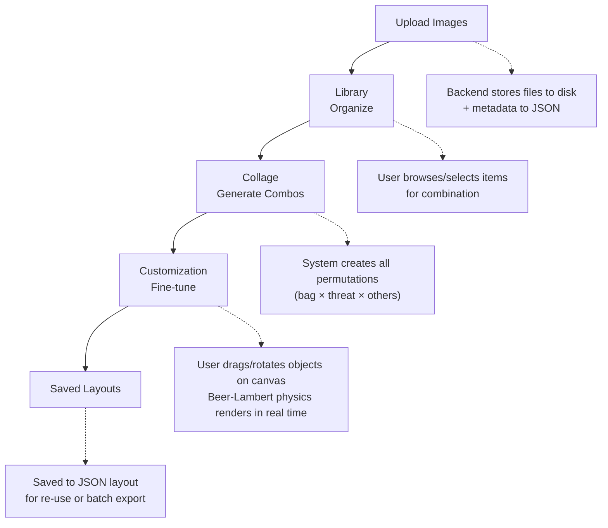

# Synthetic X-Ray Bag Scan Generation System — Complete Project Documentation

---

## Table of Contents

1. [What Are We Building?](#1-what-are-we-building-high-level-overview)
2. [Why Does This Project Exist?](#2-why-does-this-project-exist)
3. [Project Structure & Architecture](#3-project-structure--architecture)
4. [Technology Stack & Why We Chose It](#4-technology-stack--why-we-chose-it)
5. [Complete File-by-File Breakdown](#5-complete-file-by-file-breakdown)
6. [Data Storage — JSON Files & NPZ Pixel Data](#6-data-storage--json-files--npz-pixel-data)
7. [The Valid Region System — Full Mathematical Explanation](#7-the-valid-region-system--full-mathematical-explanation)
8. [How Objects Are Made Unique & Inserted (Frontend ↔ Backend ↔ Storage)](#8-how-objects-are-made-unique--inserted-frontend--backend--storage)
9. [All APIs — Complete Reference](#9-all-apis--complete-reference)
10. [The Beer-Lambert X-Ray Rendering Physics](#10-the-beer-lambert-x-ray-rendering-physics)
11. [Raw File Processing Pipeline (.dump.pgm & .tip)](#11-raw-file-processing-pipeline-dumppgm--tip)
12. [End-to-End Walkthrough: Uploading, Drawing, Customizing, Saving](#12-end-to-end-walkthrough)
13. [Performance Characteristics & File Handling Capacity](#13-performance-characteristics--file-handling-capacity)
14. [Data Synthesis Scripts](#14-data-synthesis-scripts)
15. [Docker & Deployment](#15-docker--deployment)

---

## 1. What Are We Building? (High-Level Overview)

This project is a **Synthetic X-Ray Image Generation System** — a web-based tool that generates realistic simulated X-ray scan images of bags containing various objects (clothing, electronics, food, threats like firearms/knives). These synthetic X-ray scans, complete with bounding box and segmentation annotations, are used to **train machine learning models** (YOLO, custom segmentation networks) for security baggage screening at airports.

### The Core Workflow



**In plain English:** A security researcher uploads X-ray images of bags, threats, and non-threat objects into a library. The system automatically generates all possible combinations (which bag + which threat + which other objects), lets the user visually arrange them on a canvas with realistic X-ray physics, and saves the results as annotated training data for ML models.

### Background Handling — Dual-Energy X-Ray

Real airport X-ray scanners produce dual-energy images (low-energy and high-energy channels). This system:

1. **Upload stage**: Accepts raw scanner files (`.dump.pgm` and `.tip` formats) only
2. **Processing stage**: WorkerPool with Python workers converts raw scanner files into PNG + NPZ pixel data
3. **Storage**: NPZ files contain exact 16-bit pixel values for each object in both energy channels:
   - Low-energy: `pixel_data/lowenergy/` (562 .npz files)
   - High-energy: `pixel_data/highenergy/` (561 .npz files)
4. **Rendering**: Frontend fetches NPZ pixel data via API and renders using the Beer-Lambert law with full 16-bit precision (no 8-bit quantization loss)

---

## 2. Why Does This Project Exist?

Airport security X-ray scanners produce grayscale images where different materials absorb X-rays differently. Training AI to detect threats in these images requires large labeled datasets. Collecting real X-ray scans with threats is:

- **Expensive** (requires controlled environments)
- **Limited** (cannot scan actual weapons freely)
- **Privacy-sensitive** (real passenger bags)

This system solves the problem by **synthesizing** realistic X-ray composites from individual scanned objects, using the **Beer-Lambert attenuation law** (the actual physics equation that governs X-ray absorption). The result: unlimited training data with perfect ground-truth annotations.

---

## 3. Project Structure & Architecture

```
xray/                                    # Root project directory
│
├── package.json                         # Root npm scripts orchestrating frontend/backend
├── package-lock.json                    # Root npm lockfile
├── README.md                            # Short project readme
├── DETAILED_PROJECT_DOCUMENTATION.md    # This file — complete project documentation
│
├── backend/                             # Node.js + Express + Jimp backend (flat JSON storage)
│   ├── package.json                     # Backend dependencies and scripts
│   ├── package-lock.json
│   ├── Dockerfile                       # Backend container build
│   ├── .dockerignore
│   ├── data/                            # All runtime data (images, metadata, exports)
│   │   ├── items.json                   # Main metadata store (~1.8MB, 77,892 lines)
│   │   ├── items_backup.json            # Backup copy (2 bytes — placeholder)
│   │   ├── items_1000.json              # Milestone backup at 1000 items (~3.1MB)
│   │   ├── items_2000.json              # Milestone backup at 2000 items (~6.4MB)
│   │   ├── items_3000.json              # ...continues up to
│   │   ├── items_4000.json
│   │   ├── items_5000.json
│   │   ├── items_6000.json
│   │   ├── items_7000.json
│   │   ├── items_8000.json
│   │   ├── items_9000.json
│   │   ├── items_10000.json             # Milestone backup at 10000 items (~31.9MB)
│   │   ├── savedLayouts.json            # Saved workspace layouts
│   │   ├── library_images/              # 562 PNG files — uploaded/imported X-ray images
│   │   ├── pixel_data/
│   │   │   ├── lowenergy/               # 562 .npz files — 16-bit pixel density data
│   │   │   └── highenergy/              # 561 .npz files — high-energy channel
│   │   ├── collage_images/
│   │   │   ├── high/                    # High-energy collage output directory
│   │   │   └── low/                     # Low-energy collage output directory
│   │   ├── exports/                     # Single-scene export output
│   │   └── temp/                        # Temporary processing workspace
│   │
│   └── src/
│       ├── server.js                    # Main Express server — ALL API endpoints (1414 lines)
│       ├── api/
│       │   └── datasetGenerator.js      # Batch generation engine (composites, manifests, labels)
│       └── lib/
│           ├── storage.js               # JSON file database layer (read/write items.json)
│           ├── workerPool.js            # Parallel worker pool for raw file processing
│           ├── rawFileWorker.js         # Individual worker thread for raw files
│           ├── process_raw_file.py      # Python reader for .dump.pgm / .tip scanner files
│           ├── geometry.js              # Server-side geometry and placement checks
│           └── renderCanvas.js          # Server-side Beer-Lambert rendering via Jimp
│
├── frontend/                            # React + TypeScript + Vite frontend
│   ├── package.json                     # Frontend dependencies and scripts
│   ├── package-lock.json
│   ├── index.html                       # SPA entry point
│   ├── vite.config.ts                   # Vite dev/build configuration
│   ├── tsconfig.json                    # TypeScript configuration
│   ├── tsconfig.node.json               # Node-side TypeScript config for tooling
│   ├── tailwind.config.js               # Tailwind CSS design tokens
│   ├── postcss.config.js                # PostCSS configuration
│   ├── eslint.config.js                 # ESLint configuration
│   ├── Dockerfile                       # Frontend container build (nginx)
│   ├── .dockerignore
│   ├── .env.development                 # Dev environment variables (VITE_API_URL)
│   ├── .env.docker                      # Docker environment variables
│   ├── dist/                            # Built frontend output
│   │
│   └── src/
│       ├── main.tsx                     # React 18 entry point (createRoot + StrictMode)
│       ├── App.tsx                      # Root component — Router, UploadProvider, navigation
│       ├── index.css                    # Tailwind base + custom animations + Inter font
│       ├── vite-env.d.ts                # Vite TypeScript declarations
│       ├── context/
│       │   └── UploadContext.tsx         # Shared upload staging state via React Context
│       │
│       ├── pages/
│       │   ├── UploadPage.tsx           # File upload with staging, mass-assign, validation
│       │   ├── LibraryPage.tsx          # Browse, filter, search, select library items
│       │   ├── CollagePage.tsx          # Combination viewer & batch dataset export
│       │   ├── CustomizationPage.tsx    # Interactive canvas editor with X-ray physics
│       │   └── SavedPage.tsx            # List and load saved workspace layouts
│       │
│       ├── components/
│       │   ├── upload/
│       │   │   ├── UploadDropZone.tsx   # Drag-and-drop file/folder upload zone
│       │   │   ├── UploadFileQueue.tsx  # Staged file table with inline editing
│       │   │   └── ValidRegionEditor.tsx # Shape editor for drawing valid placement regions
│       │   │
│       │   ├── library/
│       │   │   ├── SimpleLibrarySidebar.tsx  # Category/subcategory navigation sidebar
│       │   │   ├── LibraryToolbar.tsx        # Search bar, view toggle, filter controls
│       │   │   ├── SelectionTray.tsx         # Bottom tray with selected items summary
│       │   │   ├── Pagination.tsx            # Client-side pagination component
│       │   │   └── ItemCard.tsx / ItemRow.tsx # Grid card / list row display
│       │   │
│       │   ├── customization/
│       │   │   ├── CanvasArea.tsx       # Main X-ray composite canvas with mouse interaction
│       │   │   ├── ScannedBagsSidebar.tsx # Library item sidebar for adding to canvas
│       │   │   └── WorkspaceToolbar.tsx  # Undo/Redo, layer controls, save/export toolbar
│       │   │
│       │   ├── collage/
│       │   │   └── SyntheticPreview.tsx # Canvas-based preview of a single combination
│       │   │
│       │   └── common/
│       │       ├── AddSubcategoryModal.tsx  # Modal for adding new subcategories
│       │       └── ConfirmModal.tsx         # Reusable confirmation dialog
│       │
│       ├── lib/
│       │   ├── xrayRenderer.ts          # Frontend Beer-Lambert renderer (Canvas API + NPZ)
│       │   ├── xrayPhysics.ts           # Pixel combination utilities (16-bit precision)
│       │   ├── geometry.ts              # Line intersection, point-in-polygon, transforms
│       │   ├── customizationHelpers.ts   # Placement logic, random positioning, validation
│       │   └── xrayWorker.ts            # Web Worker for background X-ray rendering
│       │
│       ├── types/
│       │   ├── customization.ts         # SceneObject, StencilKind, StencilId types
│       │   ├── library.ts               # Item, TaxonomyCategory, CategorizedItems types
│       │   └── geometry.ts              # Point type definition
│       │
│       ├── config/
│       │   ├── categories.ts            # Category mapping, color themes, normalization
│       │   └── api.ts                   # API_BASE_URL constant
│       │
│       └── stencils/
│           └── (stencil type definitions)
│
├── data_synthesis/                      # Raw scanner conversion utilities and source samples
│   ├── dumpread.py                      # Reads .dump files -> PGM + color PNG
│   ├── tipread.py                       # Reads .tip files -> low/high-energy PNGs
│   ├── bags_easy/                       # Easy bag scans (.dump.pgm + color PNG)
│   ├── bags_medium/                     # Medium bag scans
│   ├── bags_hard/                       # Hard bag scans
│   ├── guns/                            # Gun .tip files and PNG previews
│   └── knife/                           # Knife .tip files and PNG previews
│
├── extracted_synthesis/                 # Extracted single PNG assets for upload
├── extracted_files_low_high/            # Low/high-energy extracted PNG channels
│
├── scripts/                             # Utility scripts
│   ├── check-buildkit.bat               # Docker BuildKit check for Windows
│   ├── disable-buildkit.ps1             # PowerShell script to disable BuildKit
│   └── generate-test-files.js           # Test file generator for upload testing
│
├── test-upload-batch/                   # Sample batch for upload testing
│   ├── bags_easy/
│   ├── bags_hard/
│   ├── bags_medium/
│   ├── guns/
│   └── knife/
│
├── docker-compose.yml                   # Multi-container Docker configuration
├── .gitignore                           # Git ignore rules
├── .dockerignore                        # Docker ignore rules
├── .gitattributes                       # Git attributes
├── bootstrap.bat                        # Windows bootstrap script
└── bootstrap.sh                         # Linux bootstrap script
```

### Why This Structure?

**Monorepo with clear separation:** The frontend and backend are separate npm packages within one repository. This allows:
- Independent dependency management
- Clear API boundary between frontend and backend
- Easy deployment (each can be deployed separately via Docker)

**Backend stores files on disk, metadata in JSON files:** Images are stored as actual files in `data/library_images/` because they need to be served as static files and processed by the image rendering engine. Metadata (category, pixel values, valid regions) lives in flat JSON files (`items.json` and `savedLayouts.json`) inside `backend/data/` for simplicity and zero-dependency portability.

**NPZ pixel data files:** Exact 16-bit pixel values are stored as compressed NumPy NPZ files in `pixel_data/lowenergy/`. These preserve the full X-ray attenuation values without the 0.2% quantization error that occurs when using 8-bit canvases (0-255 instead of 0-65535).

**Frontend is a SPA with 5 pages matching the workflow:** Each page corresponds to one step in the pipeline, making the user journey intuitive: Upload → Library → Collage → Customization → Saved.

---

## 4. Technology Stack & Why We Chose It

### Backend

| Technology | Version (from package.json) | Purpose | Why |
|---|---|---|---|
| **Node.js** | ~20+ | Runtime | Fast prototyping, async I/O for file operations, shared language with frontend |
| **Express** | ^4.21 | HTTP server, REST API | Standard Node.js web framework, minimal overhead |
| **JSON file storage** | — | Database | Zero-dependency flat files, portable, debuggable, human-readable |
| **Multer** | ^1.4.5 | File upload handling | Standard Express middleware for multipart/form-data |
| **Jimp** | ^0.22.12 | Server-side image rendering | Pure-JS image library — no native dependencies needed |
| **(not used)** | — | — | `sharp` is listed in package.json but not imported in any source file |
| **(not used)** | — | — | Item IDs come from filename roots; export IDs use timestamps |
| **cors** | ^2.8.5 | CORS middleware | Allows frontend dev server to call backend API |
| **worker_threads** | (native) | Parallel processing | Node.js built-in worker threads for raw file processing |
| **child_process** | (native) | Python subprocess | Spawns Python scripts for reading .dump.pgm / .tip formats |

### Frontend

| Technology | Version (from package.json) | Purpose | Why |
|---|---|---|---|
| **React** | ^19.0.0 | UI framework | Component-based architecture, hooks for state management |
| **TypeScript** | ~5.7.2 | Type safety | Catches errors at compile time, better IDE support |
| **Vite** | ^6.0.5 | Build tool & dev server | Fast HMR (~50ms), modern bundling, native ESM |
| **Tailwind CSS** | ^3.4.17 | Styling | Utility-first, rapid UI development, consistent design system |
| **React Router** | ^7.1.1 | Client-side routing | Standard SPA routing between 5 pages |
| **HTML Canvas API** | (browser native) | X-ray rendering | Browser-native, performant pixel manipulation for Beer-Lambert physics |
| **Lucide React** | ^0.473.0 | Icons | Lightweight, consistent SVG icon set |
| **(not used)** | — | — | `@tanstack/react-virtual` and `react-icons` are listed but not imported in any source file |

### Data Synthesis (Python)

| Script | Purpose |
|---|---|
| **dumpread.py** | Reads scanner `.dump` binary files → emits PGM + color PNG outputs |
| **tipread.py** | Reads `.tip` threat package files → extracts low/high-energy PNG channels |

### Why JSON files over SQLite/MongoDB/PostgreSQL?

The project prioritizes zero-dependency portability and fast iteration. Flat JSON files (`items.json`, `savedLayouts.json`) mean:
- No database server to install or configure
- Human-readable, easy to debug and inspect with any text editor
- Data persists in `backend/data/` and survives restarts
- Simple backup (just copy the JSON files + `library_images/` directory)
- Docker volumes map directly to these files
- **Proven scale**: The system has been tested with up to 10,000 items (milestone backups exist at 1000-item intervals up to 10000)

For a prototype/research tool this is far more practical than setting up PostgreSQL, and faster to iterate than SQLite for JSON-heavy metadata.

### Why NPZ files for pixel data?

Browser Canvas API only supports 8-bit per channel (0-255, providing only 256 levels of precision). Real X-ray data has 16-bit precision (0-65535). By storing pixel data in NumPy NPZ files:

1. Full 16-bit pixel values are preserved server-side
2. Frontend fetches the NPZ data via REST API and uses the exact values in the Beer-Lambert rendering
3. No quantization error from 8-bit canvas truncation
4. NPZ is compressed, reducing storage by ~80% compared to raw arrays

---

## 5. Complete File-by-File Breakdown

### 5.1 Root-Level Files

#### `package.json`
- **Name:** `xray`
- **Type:** Not set (CommonJS by default)
- **Purpose:** Monorepo orchestrator. Defines scripts that delegate to frontend/backend:
  - `npm run dev` — runs `dev:backend` then `dev:frontend` in sequence; for active development, run backend and frontend in separate terminals
  - `npm run dev:frontend` — starts Vite dev server on port 5174
  - `npm run dev:backend` — starts Express server on port 8080
  - `npm run build` — builds frontend for production
  - `npm run docker:dev` — runs Docker Compose for development
- **Dependencies:** Includes `canvas` at root level (shared across project)

#### `docker-compose.yml`
- Defines 2 services:
  - `frontend`: Builds from `frontend/Dockerfile`, runs on port 5174 (dev) / 80 (prod)
  - `backend`: Builds from `backend/Dockerfile`, runs on port 8080, mounts `./backend/data` as volume

#### `README.md`
- Short README with project name and brief description

#### `package-lock.json`
- Locks the root npm dependency graph

#### `.gitignore`
- Ignores `node_modules/`, `dist/`, `backend/data/`, `.env`, `*.log`

#### `.dockerignore`
- Ignores `node_modules/`, `dist/`, `data/`

#### `.gitattributes`
- Git attribute settings

#### `bootstrap.bat` / `bootstrap.sh`
- Quick-start scripts that install dependencies for both frontend and backend

---

### 5.2 Backend Files (`backend/`)

#### `backend/package.json`
- **Name:** `synthetic-xray-backend`
- **Type:** `"module"` (ESM imports)
- **Key dependencies:** `express`, `cors`, `multer`, `jimp`
- **Key scripts:**
  - `dev` — runs `src/server.js` with `--watch` flag via Node 20
  - `start` — runs `src/server.js`

#### `backend/Dockerfile`
- Multi-stage build:
  - Base: `node:20-slim`
  - Installs Python + `python3-numpy` for NPZ file processing
  - Copies `backend/` source
  - Exposes port 8080
  - Runs `npm start`

#### `backend/src/server.js` — THE MAIN SERVER (1414 lines)

This is the heart of the backend — a single monolithic Express server handling ALL functionality.

**Startup Sequence:**
1. Creates Express app with CORS (origin: `http://localhost:5174`, `http://localhost`) and JSON body parsing (50MB limit for pixel data)
2. Sets up static file serving: `app.use('/data', express.static('data'))` — this is how the frontend accesses uploaded images
3. Loads metadata storage from flat JSON files via `backend/src/lib/storage.js`
4. Sets up Multer for file uploads (preserves original filenames in `data/library_images/`; `_copy####` counters added on collision)
5. Creates required directories (`exports/`, `library_images/`, `collage_images/`, `pixel_data/`, `temp/`)
6. Uses `WorkerPool` for parallel raw file processing (`.dump.pgm` and `.tip`)
7. Seeds default subcategories for "bags", "threats", "non-threats"
8. Starts listening on port 8080

**API Endpoints (18 total):**

| Endpoint | Method | Purpose |
|---|---|---|
| `/api/health` | GET | Health check |
| `/api/upload` | POST | Upload library images |
| `/api/items/categorized` | GET | Get all items organized by category/subcategory |
| `/api/items/:id` | GET | Get single item details |
| `/api/items/:id` | PUT | Update item metadata |
| `/api/items/:id` | DELETE | Delete an item and its file |
| `/api/items/:id/valid-region` | PUT | Update bag's valid region |
| `/api/items/:id/valid-region` | DELETE | Clear bag's valid region |
| `/api/items/:id/pixel-data` | GET | Retrieve per-item pixel density data (NPZ) |
| `/api/process-raw-files` | POST | Process `.dump.pgm` / `.tip` files via worker pool (NDJSON streaming) |
| `/api/items/reorder` | POST | Reorder items in storage |
| `/api/saved-layouts` | GET | List all saved layouts |
| `/api/saved-layouts` | POST | Save a new layout |
| `/api/saved-layouts/:id` | GET | Get single saved layout |
| `/api/saved-layouts/:id` | DELETE | Delete a saved layout |
| `/api/export` | POST | Export single custom composite |
| `/api/dataset/generate` | POST | Batch generate dataset from combinations |
| `/api/dataset/generate-high` | POST | Generate high-energy dataset variants |

#### `backend/src/lib/storage.js` — JSON FILE DATABASE LAYER

Flat file replacement for a SQL database. All metadata lives in two JSON files:

- **`items.json`** — Array of item records (current size: 1.8MB, 77,892 lines)
- **`savedLayouts.json`** — Array of saved workspace layout records

**Key functions exported:**
- `loadItems()` — Reads and parses `items.json`
- `saveItems(items)` — Writes items array to `items.json`
- `createItem(item)` — Adds item to array and saves
- `updateItem(id, updates)` — Finds item by ID, applies updates, saves
- `deleteItem(id)` — Removes item by ID, saves
- `loadLayouts()` / `saveLayouts(layouts)` / `createLayout(layout)` / `deleteLayout(id)` — Same pattern for layouts

**No database transactions** — writes are atomic file writes using `fs.promises.writeFile`.

#### `backend/src/lib/workerPool.js` — PARALLEL RAW FILE PROCESSOR POOL

- Manages a pool of worker threads for processing `.dump.pgm` and `.tip` files
- Uses Node.js `worker_threads` module
- Coordinates parallel execution across multiple CPU cores
- Streams progress updates back to the client via NDJSON (Newline-Delimited JSON)

**How it works:**
1. Receives array of file paths to process
2. Distributes work across available worker threads (configurable pool size)
3. Each worker runs `rawFileWorker.js` which spawns a Python subprocess
4. Progress and results are streamed back line-by-line as NDJSON
5. Client sees real-time progress: `{"type":"progress","current":5,"total":20,"file":"..."}`

#### `backend/src/lib/rawFileWorker.js` — INDIVIDUAL WORKER THREAD

- Single worker thread executed by `workerPool.js`
- Spawns Python subprocess running `process_raw_file.py`
- Communicates results back to the pool via `parentPort.postMessage()`

#### `backend/src/lib/process_raw_file.py` — PYTHON RAW FILE READER

- Called as a subprocess by `rawFileWorker.js`
- Reads `.dump.pgm` binary scanner files and `.tip` threat files
- Extracts:
  - Low-energy and high-energy image channels
  - Full 16-bit pixel values
  - Image dimensions and metadata
- Outputs processed PNG images + NPZ pixel data files

#### `backend/src/lib/geometry.js` — SERVER-SIDE GEOMETRY

Mirrors the frontend `geometry.ts` for server-side placement calculations during batch generation.

**Functions:**
- `isPointInPolygon(point, polygon)` — Ray casting algorithm
- `getRectCorners(center, size, rotation)` — Compute 4 corners of rotated rectangle
- `getTransformedPolygon(center, size, rotation, outline)` — Transform arbitrary polygon
- `edgeIntersectsPolygon(edge, polygon)` — Check if edge crosses polygon boundary
- `getRandomPositionInContainer(width, height, container, polygonOutline)` — Random placement within valid region

#### `backend/src/lib/renderCanvas.js` — SERVER-SIDE RENDERING

Server-side equivalent of `xrayRenderer.ts`. Uses `jimp` (pure-JS image library) to render X-ray composites for batch export.

**Algorithm:**
1. Creates a blank image buffer (white = no X-ray absorption)
2. For each object (sorted by layer):
   - Loads the image file via Jimp
   - Extracts the alpha channel as a "thickness map"
   - Accumulates density: `densityBuffer[pixel] += mu * (alpha / 255)` where `mu = -ln(max(1, pixelValue) / 65535)`
3. Converts density to grayscale: `intensity = 65535 * e^(-density)`
4. Writes final PNG via Jimp

#### `backend/src/api/datasetGenerator.js` — BATCH GENERATION ENGINE

Handles both single-image export and batch dataset generation.

**Single Export Flow (`POST /api/export`):**
1. Receives scene objects with transforms
2. Calls `renderSceneAsync()` to generate PNG using Beer-Lambert physics
3. Calculates bounding boxes and segmentation polygons for each object
4. Saves PNG + JSON annotation

**Batch Generation Flow (`POST /api/dataset/generate`):**
1. Receives array of combinations (bag + threat + others)
2. For each combination:
   a. Places bag at center (75% of canvas)
   b. Randomly places threat inside bag's valid region using `getRandomPositionInContainer()`
   c. Randomly places other items inside valid region
   d. Renders composite using Beer-Lambert physics
   e. Generates YOLO-format bounding box annotations
   f. Saves PNG + JSON label file
3. Returns manifest with all file paths

---

### 5.3 Frontend Files (`frontend/src/`)

#### `main.tsx`
- Standard React 18 entry point using `createRoot` with StrictMode
- Imports `App`, `index.css`, and `BrowserRouter`

#### `App.tsx` — ROOT COMPONENT (161 lines)

- Wraps app in `UploadProvider` for shared upload staging state
- Sets up React Router with 5 routes:
  - `/` → `UploadPage`
  - `/library` → `LibraryPage`
  - `/collage` → `CollagePage`
  - `/customize` → `CustomizationPage`
  - `/saved` → `SavedPage`
- Renders sticky top navigation bar with icons and HelpMenu
- Navigation items: Upload (Home icon), Library (BookOpen), Collage (LayoutGrid), Customize (Wand2), Saved (Clock)

#### `index.css`
- Tailwind CSS imports (`@tailwind base`, `components`, `utilities`)
- Inter font family
- Custom CSS animations: `slide-up`, `fade-in`, `slide-in-right`

#### `context/UploadContext.tsx`
- Provides shared upload staging state around the app via `UploadProvider`
- State: `files: File[]`, `staged: StagedItem[]`, `clearAll()`, `setFiles()`, `setStaged()`
- Keeps upload-related state out of the top-level router

---

### 5.4 Pages (`frontend/src/pages/`)

#### `UploadPage.tsx` — FILE UPLOAD (545 lines)

**State Management (local + context):**
- `uploading: boolean` — whether upload is in progress
- `uploadStatus: "idle" | "success" | "error"` — toast notification
- `folderName: string` — optional folder grouping
- `selectedForMass: Set<number>` — which items are checked in mass-assign
- `processing: boolean` — raw file processing in progress
- `processingProgress: { current: number; total: number }` — progress tracking
- `duplicateFilenames: string[]` — detected duplicates
- `streamErrors: string[]` — errors from raw file processing
- Context: `files`, `staged`, `setFiles`, `setStaged`, `clearAll`

**How Upload Works:**

1. **File Selection** — `UploadDropZone` accepts `.dump.pgm` and `.tip` files only (raw scanner formats)
   - Calls `handleFilesSelected()` which validates duplicates, filters invalid types
   - Creates `StagedItem[]` with default metadata

2. **Mass Assign Category** — Panel appears immediately with checkboxes
   - User can pick category + subcategory and click "Apply to Selected"
   - Newly added files auto-selected; panel stays visible for reuse

3. **Staged File Queue** — `UploadFileQueue` displays files in horizontal table with columns:
   - Checkbox, #, Image thumbnail (canvas), Category dropdown, Subcategory dropdown, Name, Valid Region button, Remove button
   - Category/Subcategory dropdowns default to "NONE"; user selects inline
   - For bags: "Set" / "Edit" button opens `ValidRegionEditor`

4. **Upload validation:**
   - All items must have category/subcategory selected
   - Bags must have a valid region drawn before upload
   - Warning toasts identify items needing attention with serial numbers

5. **Upload execution:**
   - Creates `FormData` with all files
   - Appends `metadata` JSON string with per-file settings
   - POSTs to `/api/upload`
   - On success: clears staged files, shows success toast

6. **Navigation guard:** `useBlocker` prevents accidental navigation away with unsaved staged files

#### `LibraryPage.tsx` — ITEM BROWSER

**Features:**
- Fetches all items from `GET /api/items/categorized`
- Organizes into 3 main tabs: Bags, Threats, Non-Threats
- Subcategory filter within each tab
- Search by name (client-side filtering)
- Grid/List view toggle
- Multi-select items via checkboxes (persisted to `localStorage` as `selectedItems` — a Set of item IDs)
- Selection tray at bottom showing selected items with "Generate Combinations" button
- Individual item editing (change category/subcategory/name)
- Individual item deletion with confirmation
- Client-side pagination via `Pagination.tsx` component

**Key Flow:**
1. User selects bags, threats, and other items
2. Clicks "Generate Combinations" → navigates to CollagePage with selected items in `location.state`
3. Selection persists across browser restarts via `localStorage`

#### `CollagePage.tsx` — COMBINATION VIEWER & BATCH EXPORT

**How Combinations Are Generated:**
1. Receives `selectedBags`, `selectedThreats`, `selectedOthers` from LibraryPage via `location.state`
2. Creates Cartesian product:
   - For each bag: one "clean" combo (bag + others)
   - For each bag × threat: one combo (bag + threat + others)
3. Client-side validation: skips combos where bag has no valid region but threat exists
4. Density presets: "empty" (no others), "few" (1-2 others), "filled" (all others)

**State Persistence:**
- Combinations stored in `sessionStorage` (survives page refresh)
- Selection stored in `localStorage` (survives browser restart between sessions)

**Export Flow:**
1. User clicks "Generate Dataset"
2. Sends `POST /api/dataset/generate` with all combinations
3. Backend renders each combination as PNG + JSON annotation
4. Results saved to `backend/data/collage_images/dataset-{timestamp}/`

#### `CustomizationPage.tsx` — INTERACTIVE CANVAS EDITOR

This is the most complex page — a full visual editor for arranging objects on an X-ray composite.

**State:**
- `objects: SceneObject[]` — all objects on the canvas (bag, threats, others)
- `selectedObjectId: string | null` — currently selected object
- `history / historyIndex` — undo/redo stack (full history of edits)
- `showValidRegion: boolean` — toggle valid region polygon visibility
- `zoom: number` — canvas zoom level (0.5 to 2.0)
- `activeLibrary: string` — which sidebar panel is open

**Object Initialization (from URL params):**
1. On mount, fetches all items from `GET /api/items/categorized`
2. Reads `bagId`, `threatId`, `otherIds` from URL search params
3. Checks `localStorage` for previously saved workspace state
4. If no saved state, calls `buildAndSetObjects()`:
   a. Finds the bag item, sets it at canvas center (85% of smallest canvas dimension)
   b. Finds other items, places each at random position inside bag's valid region
   c. Finds threat item, places at random position inside bag's valid region
5. Each object gets a `SceneObject` with: id, name, category, filepath, pixel values, transform, layer, polygon outline

**Interactive Features:**
- **Drag:** Click and drag non-bag objects to reposition
- **Rotate:** Click rotation handle and drag
- **Layer ordering:** Bring to front, send to back, move up/down
- **Delete:** Remove selected object
- **Undo/Redo:** Full history stack with keyboard shortcuts
- **Properties panel:** Shows selected object's position, category, pixel values, validity status
- **Out-of-bounds warnings:** Shows which threats are outside the valid region
- **Export:** Saves layout to JSON via `POST /api/saved-layouts`

**Canvas Rendering (via CanvasArea component):**
Uses `xrayRenderer.ts`'s `drawXRayComposite()` which:
1. Creates a Float32Array density buffer (canvas width × height)
2. For each object (sorted by layer):
   - Draws image on offscreen canvas with transform
   - Extracts alpha channel
   - Calculates attenuation: `mu = -ln(pixelValue / 65535)`
   - Accumulates: `densityBuffer[i] += mu * (alpha / 255)`
3. Converts to grayscale: `intensity = 65535 * e^(-density)`
4. Draws result to visible canvas

#### `SavedPage.tsx`
- Lists all saved layouts from `GET /api/saved-layouts`
- Each layout shows creation time
- Can be loaded back into CustomizationPage
- Delete individual layouts

---

### 5.5 Components (`frontend/src/components/`)

#### `ValidRegionEditor.tsx` — THE SHAPE DRAWING TOOL

A full-featured shape editor for drawing valid placement regions on bag images. Like a mini Photoshop for defining where objects can be placed inside a bag.

**Tools:**
- **Select/Move:** Click to select shapes, drag to move
- **Rectangle:** Click and drag to draw rectangles
- **Circle:** Click and drag to draw circles
- **Polygon:** Click to add points, click near first point to close

**Features:**
- **Positive/Negative shapes:** Shapes can add to (positive) or subtract from (negative) the valid region
- **Layer management:** Reorder shapes, lock/unlock, show/hide
- **Grid snap:** Optional snap-to-grid (10/20/50px)
- **Zoom/Pan:** Ctrl+scroll to zoom, middle-click or space+drag to pan
- **Undo/Redo:** Full history
- **Copy/Paste:** Clipboard support
- **Context menu:** Right-click for shape-specific actions
- **Mask export:** Export the valid region as a black/white PNG mask
- **Opacity control:** Adjust shape transparency

**How Shapes Are Saved:**
1. User draws shapes on the bag image canvas
2. On Save, all shapes are normalized to 0-1 range (divide by canvas dimensions)
3. A "simplified points" array is extracted from the first positive rectangle/polygon
4. Calls `onSave(simplifiedPoints, normalizedShapes)`
5. Parent component stores this as `valid_region_points` in the staged item

**Why normalized (0-1)?** Resolution-independent — the same polygon works whether the bag image is displayed at 200px or 2000px.

#### `upload/UploadDropZone.tsx`
- Drag-and-drop zone that accepts files and folders
- Visual feedback with dashed border and icon change on drag-over
- Accepts `.dump.pgm` and `.tip` files only (raw scanner formats)

#### `upload/UploadFileQueue.tsx`
- Displays staged files in a horizontal scrollable table
- Columns: checkbox, #, Image (canvas thumbnail with valid region overlay), Category dropdown, Subcategory dropdown, Name, Valid Region button, Remove button
- Thumbnail uses a `<canvas>` element rendering the image + semi-transparent blue polygon overlay showing the valid region
- Footer includes "Delete Selected (N)" button for bulk removal
- Checkboxes in each row sync with Mass Assign panel selection

#### `customization/CanvasArea.tsx`
- Renders the main canvas with X-ray composite
- Handles mouse events for dragging/rotating objects
- Draws valid region polygon overlay (green dashed line)
- Shows selection handles on selected objects
- Supports zoom and pan

#### `customization/ScannedBagsSidebar.tsx`
- Left sidebar showing all available items from the library
- Organized by category tabs (Bags, Threats, Non-Threats)
- Click to add an item to the canvas

#### `customization/WorkspaceToolbar.tsx`
- Top toolbar with: Undo, Redo, Valid Region toggle, Layer controls, Randomize, Save/Export
- Keyboard shortcut indicators

#### `library/SimpleLibrarySidebar.tsx`
- Left sidebar for LibraryPage with category/subcategory navigation
- Shows item counts per subcategory

#### `library/ItemCard.tsx` / `ItemRow.tsx`
- Grid card / list row display for library items
- Shows thumbnail, name, category badge, pixel value
- Checkbox for multi-selection

#### `library/SelectionTray.tsx`
- Bottom tray showing selected items
- Shows counts per category (bags, threats, non-threats)
- "Generate Combinations" button → navigates to CollagePage

#### `library/LibraryToolbar.tsx`
- Search bar with real-time filtering
- View mode toggle (grid/list)
- Filter controls

#### `library/Pagination.tsx` (115 lines)
- Client-side pagination component
- Props: `currentPage`, `totalPages`, `onPageChange`, `itemsPerPage`, `totalItems`
- Features:
  - Shows range: "Showing 1 to 20 of 562 items"
  - Previous/Next buttons with disabled states
  - Page number buttons with ellipsis for large page counts
  - Max 5 visible page buttons with "..." truncation
  - Active page highlighted with accent color
  - Responsive: "Previous"/"Next" text hidden on small screens

#### `collage/SyntheticPreview.tsx`
- Canvas-based preview of a single combination
- Uses `drawXRayComposite()` to render the X-ray in real-time

#### `common/AddSubcategoryModal.tsx`
- Modal dialog for adding new subcategories to the taxonomy

#### `common/ConfirmModal.tsx`
- Reusable confirmation dialog for delete operations

---

### 5.6 Core Logic (`frontend/src/lib/`)

#### `xrayRenderer.ts` — FRONTEND BEER-LAMBERT RENDERER (365 lines)

The most important file for understanding how X-ray composites are rendered in the browser.

**Image Caching:**
```typescript
export const imgCache = new Map<string, HTMLImageElement>();
export const pixelDataCache = new Map<string, number[][]>();
```
Images are loaded once from `http://localhost:8080/data/library_images/{filepath}` and cached. Pixel data from NPZ files is also cached after first fetch.

**16-bit Pixel Data Fetching:**
```typescript
export async function fetchPixelData(itemId: string, energyType: string = "highenrgy"): Promise<number[][] | null>
```
Fetches exact 16-bit pixel values from server's NPZ files, avoiding the 0.2% quantization error from browser canvas 8-bit truncation. Default energy type is `"highenrgy"` (note the typo in the code — not `"highenergy"`).

**Rendering Algorithm (`drawXRayComposite()`):**

```
1. Fill canvas with white (R=255, G=255, B=255)
   → White = no X-ray absorption (empty space)

2. Sort objects by layer number (lowest first = background first)

3. Create Float32Array densityBuffer[width × height] (all zeros)

4. For each object:
   a. Draw image on offscreen canvas with transform (translate, rotate, scale)
   b. Extract RGBA pixel data
   c. Calculate attenuation coefficient:
      mu = -ln(max(1, pixelValue) / 65535)
      Where pixelValue (0-65535) represents how much X-ray the object absorbs:
      - pixelValue = 65535 → mu ≈ 0 (transparent, like air)
      - pixelValue = 1 → mu ≈ 10.9 (very dense, like metal)
      - pixelValue = 32767 → mu ≈ 0.693 (medium, like cloth)
   d. For each pixel:
      - Skip if alpha = 0 (transparent)
      - Skip if pixel is near-white (R,G,B ≥ 245) — background noise
      - normalizedThickness = alpha / 255
      - densityBuffer[pixel] += mu × normalizedThickness

5. Convert density buffer to final grayscale image:
   For each pixel:
     intensity = 65535 × e^(-density)
     gray = round((intensity / 65535) × 255)
   This is the Beer-Lambert Law: I = I₀ × e^(-μt)
   Where I₀ = 65535 (initial intensity), μ = attenuation coefficient, t = thickness

6. Draw grayscale image to visible canvas
```

**Per-Object Pixel Statistics (`computeObjectStats()`):**
After rendering the composite, computes per-object statistics by:
1. Rendering each object individually to get its alpha mask
2. At each pixel where the object appears, reading the synthesized value from the final composite
3. Computing mean, min, and max of those values

#### `xrayPhysics.ts` — PIXEL COMBINATION UTILITIES

**`combinePixels(i1, i2)` — Direct multiplication:**
```typescript
result = (i1 × i2) / 65535
```
This is the core per-pixel combination formula. It preserves full 16-bit precision.

**`to16Bit(value)` / `to8Bit(value)` — Range conversion:**
```typescript
to16Bit: 8-bit (0-255) → 16-bit (0-65535): value × 257
to8Bit:  16-bit (0-65535) → 8-bit (0-255): value / 257
```

#### `geometry.ts` — GEOMETRY UTILITIES

**`isPointInPolygon(point, polygon)` — Ray Casting Algorithm:**
```
For each edge of the polygon:
  Cast a horizontal ray from the point to the right
  Count how many polygon edges it crosses
  If odd → point is inside; if even → point is outside
```

**`getRectCorners(center, size, rotation)` — Rotated Rectangle:**
```
4 corners at (±halfW, ±halfH) in local space
Apply rotation matrix:
  rotX = dx × cos(θ) - dy × sin(θ)
  rotY = dx × sin(θ) + dy × cos(θ)
Translate to center position
```

**`getTransformedPolygon(center, size, rotation, outline)` — Arbitrary Polygon Transform:**
```
For each point in the outline:
  Scale by size: dx = p.x × width, dy = p.y × height
  Rotate by angle
  Translate to center
```

**`lineSegmentsIntersect(p1,p2,p3,p4)` — CCW Method:**
Uses counter-clockwise orientation test to detect segment intersection.

#### `customizationHelpers.ts` — PLACEMENT & PIXEL MATH

**`getTransformedValidRegion(bag)` — Converts stored polygon to canvas coordinates:**
```
1. Take the bag's polygonOutline (normalized 0-1 points)
2. Map each point: x = p.x × displayWidth, y = p.y × displayHeight
3. Apply rotation and translation to get canvas-space coordinates
```

**`isObjectInsideContainer(obj, container)` — Boundary Check:**
```
1. Get the container's valid region (transformed polygon)
2. Get the object's outline (transformed polygon or rotated rectangle)
3. Check: Are ALL object corners inside the valid region?
4. Check: Does ANY object edge cross the valid region boundary?
5. If both pass → object is inside
```

**`getRandomPositionInContainer(width, height, container, polygonOutline)` — Random Placement:**
```
1. Get valid region bounding box (min/max x,y)
2. Try up to 1000 random positions:
   a. Generate random (x, y) within bounding box
   b. Generate random rotation (0-360°)
   c. Check if object at that position is inside container
   d. If yes → return position
   e. Progressive relaxation: after 100 attempts, shrink object by 20%
      after 300 attempts, shrink by 50%, after 600 attempts, use center point
3. Fallback: return centroid of valid region
```

#### `xrayWorker.ts` — WEB WORKER FOR BACKGROUND RENDERING

A Web Worker that runs the X-ray rendering algorithm off the main thread, allowing the UI to remain responsive during complex renders.

---

### 5.7 Types (`frontend/src/types/`)

#### `customization.ts`
```typescript
type SceneObject = {
  id: string;                    // Unique identifier
  name: string;                  // Display name
  library: StencilKind;          // "bag" | "threat" | "clothes" | etc.
  originalPixelValue: number;    // DB pixel value (0-65535)
  currentPixelValue: number;     // After overlap adjustment
  oldPixelValue: number | null;  // Previous value (for undo)
  stencilId: StencilId;          // Internal stencil reference
  filepath?: string;             // Path in library_images/
  polygonOutline?: Point[];      // Normalized polygon (0-1 range)
  transform: {                   // Canvas-space transform
    x: number;                   // Center X
    y: number;                   // Center Y
    width: number;               // Display width
    height: number;              // Display height
    rotation: number;            // Degrees
  };
  initialWidth?: number;         // Original image width
  initialHeight?: number;        // Original image height
  layer: number;                 // Z-order (lower = behind)
};
```

#### `geometry.ts`
```typescript
type Point = { x: number; y: number };
```

#### `library.ts`
```typescript
type Item = {
  id: string;
  filename: string;
  filepath: string;
  category: string;
  subcategory: string;
  name: string;
  pixel_value: number;
  width: number;
  height: number;
  polygon_json: any;
  valid_region_points?: any;
  mask_path?: string;
};

type TaxonomyCategory = {
  name: string;
  slug: string;
  subcategories: TaxonomySubcategory[];
};

type CategorizedItems = Record<string, Record<string, Item[]>>;
```

---

### 5.8 Configuration (`frontend/src/config/`)

#### `categories.ts`

**`CATEGORY_MAP`:** Maps category slugs to Tailwind CSS class sets for consistent styling:
```
bags → blue theme
threats → rose/red theme
non-threats → gray theme
```

**`normalizeCategoryName(cat)`:** Normalizes any category string to 1 of 3 canonical values:
- Contains "bag" → "bags"
- Contains "threat" or "electronic" → "threats"
- Everything else → "non-threats"

**`LIBRARIES_UI`:** UI configuration for the 3 main library tabs: Bags, Threats, Non-Threats

**`getLibrarySubcategories(categorySlug)`:** Returns subcategories for a given library category

#### `api.ts`
```typescript
export const API_BASE_URL = "http://localhost:8080";
```

---

## 6. Data Storage — JSON Files & NPZ Pixel Data

The current codebase uses **flat JSON files** (`items.json`, `savedLayouts.json`) and **NPZ pixel data files** — there is no SQL database.

### Data Storage Architecture

```
┌───────────────────────┐
│    items.json         │ ← Array of item objects (primary metadata store)
│  (1.8 MB, 77,892 ln) │
└──────────┬────────────┘
           │
           ├── Each item has: id, filename, filepath, category, subcategory,
           │                  name, pixel_value, width, height, polygon_json,
           │                  mask_path, valid_region_points
           │
           ├── Category types: "bags", "threats", "non-threats"
           │
           └── Subcategory assignment: free-text string per item

┌───────────────────────┐
│  savedLayouts.json    │ ← Array of saved workspace layouts
│   (small file)        │
└───────────────────────┘
    Each layout: id, name, filepath, layout_json (full scene state), created_at

┌───────────────────────────────┐
│  pixel_data/lowenergy/        │ ← 562 .npz files (16-bit pixel density)
│   *.npz files                 │
└───────────────────────────────┘
    Each NPZ file contains a 2D array of 16-bit pixel values
    Corresponds 1:1 with library_images/ PNG files
    Named: {itemId}_copy####.npz

┌───────────────────────────────┐
│  pixel_data/highenergy/       │ ← 561 .npz files — high-energy channel
└───────────────────────────────┘
```

### Item Storage Structure (items.json)

Each item in `items.json` has this structure:

```json
{
  "id": "P01X010-2024101200923_copy0001",
  "filename": "P01X010-2024101200923.png",
  "filepath": "P01X010-2024101200923_copy0001.png",
  "category": "bags",
  "subcategory": "General",
  "name": "P01X010-2024101200923",
  "pixel_value": 32767,
  "width": 512,
  "height": 512,
  "polygon_json": null,
  "valid_region_points": {
    "version": 2,
    "simplifiedPoints": [
      { "x": 0.1, "y": 0.1 },
      { "x": 0.9, "y": 0.1 },
      { "x": 0.9, "y": 0.9 },
      { "x": 0.1, "y": 0.9 }
    ],
    "shapes": [...]
  },
  "mask_path": null
}
```

### Filename Deduplication Strategy

When a file is uploaded with a filename that already exists in `library_images/`, the backend appends a `_copy####` counter:

```
P01X010-2024101200923.png           # Original
P01X010-2024101200923_copy0001.png  # First duplicate
P01X010-2024101200923_copy0002.png  # Second duplicate
...
P01X010-2024101200923_copy0022.png  # 22nd duplicate (present in data)
```

### Milestone Backups (Proof of Scale)

The system has been tested at various scales, with milestone backup files:

| Milestone | File Size | Lines (approx) |
|---|---|---|
| Current (items.json) | 1.8 MB | 77,892 |
| 1,000 items | 3.1 MB | — |
| 2,000 items | 6.4 MB | — |
| 3,000 items | 9.6 MB | — |
| 4,000 items | 12.8 MB | — |
| 5,000 items | 16.0 MB | — |
| 6,000 items | 19.2 MB | — |
| 7,000 items | 22.4 MB | — |
| 8,000 items | 25.5 MB | — |
| 9,000 items | 28.7 MB | — |
| 10,000 items | 31.9 MB | — |

Each milestone file is a complete snapshot of the database at that item count, proving the system has been tested with up to 10,000 items.

### NPZ Pixel Data Format

NPZ files are compressed NumPy archives (`.npz`) containing a single 2D array of 16-bit unsigned integers (0-65535). These represent the exact X-ray attenuation values for each pixel of an object.

**Files present:**
- `pixel_data/lowenergy/` — **562 .npz files** (one per library image)
- `pixel_data/highenergy/` — **561 files** (high-energy channel)

**How NPZ files are named:**
```
{itemId}.npz   → e.g., P01X010-2024101200923_copy0001.npz
```
The item ID matches the filename in `library_images/` and the ID in `items.json`, creating a 1:1 correspondence.

**How NPZ data is fetched:**
Frontend calls `GET /api/items/:id/pixel-data?energy=lowenergy` which reads and returns the NPZ array as JSON.

---

## 7. The Valid Region System — Full Mathematical Explanation

### What Is a Valid Region?

A **valid region** is a polygon that defines where objects can be placed inside a bag. When generating synthetic X-ray images, threats and other objects must be placed within this region to look realistic (objects don't float outside bags in real X-ray scans).

### How Is It Stored?

The valid region is stored in `items.json` as part of the bag item's record, in the `valid_region_points` field. It can exist in two versions:

**Version 1 (simple):** Just an array of normalized points
```json
[
  { "x": 0.1, "y": 0.1 },
  { "x": 0.9, "y": 0.1 },
  { "x": 0.9, "y": 0.9 },
  { "x": 0.1, "y": 0.9 }
]
```

**Version 2 (structured):** Contains both simplified points and full shape data (drawn from ValidRegionEditor)
```json
{
  "version": 2,
  "simplifiedPoints": [
    { "x": 0.1, "y": 0.1 },
    { "x": 0.9, "y": 0.1 },
    { "x": 0.9, "y": 0.9 },
    { "x": 0.1, "y": 0.9 }
  ],
  "shapes": [
    {
      "type": "rectangle",
      "isPositive": true,
      "x": 0.1, "y": 0.1,
      "width": 0.8, "height": 0.8,
      "visible": true,
      "locked": false,
      "label": "Rectangle 1",
      "opacity": 0.35
    }
  ]
}
```

### Why Normalized (0-1) Coordinates?

All valid region coordinates are stored as **normalized values between 0 and 1**, where:
- `x = 0` means the left edge of the image
- `x = 1` means the right edge of the image
- `y = 0` means the top edge of the image
- `y = 1` means the bottom edge of the image

**Why?** Because bag images come in different sizes (512×512, 1024×768, etc.). By normalizing to 0-1, the same valid region polygon works regardless of the actual image dimensions. When rendering, we multiply by the display size:

```
canvas_x = normalized_x × displayWidth
canvas_y = normalized_y × displayHeight
```

### Mathematical Transform Pipeline

When the CustomizationPage needs to use the valid region, here's the complete mathematical pipeline:

**Step 1: Load normalized polygon from database**
```
polygon = [{x: 0.1, y: 0.15}, {x: 0.85, y: 0.15}, {x: 0.85, y: 0.85}, {x: 0.1, y: 0.85}]
```

**Step 2: Map to display coordinates**
The bag is displayed at a certain size on the canvas (e.g., 510×510 pixels centered at 400,300):
```
For each point p in polygon:
  dx = p.x × displayWidth    // e.g., 0.1 × 510 = 51
  dy = p.y × displayHeight   // e.g., 0.15 × 510 = 76.5
```

**Step 3: Apply rotation**
If the bag is rotated by θ degrees:
```
rad = θ × π / 180
rotX = dx × cos(rad) - dy × sin(rad)
rotY = dx × sin(rad) + dy × cos(rad)
```

**Step 4: Translate to canvas position**
```
finalX = bagCenterX + rotX    // e.g., 400 + rotX
finalY = bagCenterY + rotY    // e.g., 300 + rotY
```

### Point-in-Polygon Test (Ray Casting Algorithm)

To check if an object is inside the valid region, we use the **ray casting algorithm**:

```
function isPointInPolygon(point, polygon):
  inside = false
  for each edge (polygon[i], polygon[j]):
    if ((yi > point.y) ≠ (yj > point.y)) AND
       (point.x < (xj - xi) × (point.y - yi) / (yj - yi) + xi):
      inside = !inside
  return inside
```

**How it works:** Cast a horizontal ray from the point to the right. Count how many polygon edges it crosses. Odd = inside, even = outside.

### Object-Inside-Container Validation

To check if an entire object is inside the bag's valid region:

```
1. Get the object's outline polygon (4 corners of its bounding rectangle, transformed with rotation)
2. Get the bag's valid region polygon (transformed with bag's position, size, rotation)
3. CHECK 1: Are ALL corners of the object inside the valid region?
   - For each corner point: isPointInPolygon(corner, validRegion)
4. CHECK 2: Does ANY edge of the object cross the valid region boundary?
   - For each object edge: edgeIntersectsPolygon(edge, validRegion)
5. If both checks pass → object is validly placed
```

### Why Not Just Use a Bounding Box?

The valid region is a **polygon**, not a simple rectangle, because:
1. Real bags aren't perfect rectangles — they have curves, irregular shapes
2. The valid placement area might be L-shaped or have holes (using negative shapes)
3. The ValidRegionEditor supports rectangles, circles, and arbitrary polygons
4. Using a polygon gives much more realistic object placement

---

## 8. How Objects Are Made Unique & Inserted (Frontend ↔ Backend ↔ Storage)

### Uniqueness via Item IDs

Items get their **ID from the filename root** (the original filename without extension). Dedup counters (`_copy####`) handle duplicate filenames:

```
P01X010-2024101200923.png    → ID: P01X010-2024101200923
P01X010-2024101200923_copy0001.png → ID: P01X010-2024101200923_copy0001
```

### The Complete Upload Flow (Frontend → Backend → Storage)

**Step 1: Frontend — User drags files into UploadDropZone**
```
UploadDropZone.onFilesSelected(files)
  → Creates StagedItem[] with default metadata:
    { file, category: "bags", subcategory: "General", name: filename, valid_region_points: null }
```

**Step 2: Frontend — Mass assign categories**
```
Mass Assign panel:
  - User selects files via checkboxes (auto-selected for newly added files)
  - Picks category + subcategory from dropdowns
  - Clicks "Apply to Selected" to mass-assign
  - Panel stays visible for reuse
  - Re-adding files auto-selects only the new ones
```

**Step 3: Frontend — Edit individual items (optional)**
```
UploadFileQueue:
  - User can change category/subcategory/name inline in the table
  - For bags: draws valid region → ValidRegionEditor → normalized polygon points
  - StagedItem updated with user's choices
```

**Step 4: Frontend — Validation before upload**
```
handleUpload():
  1. Check all items have category/subcategory selected
  2. Check all bag items have valid_region_points set
  3. Show warning toasts with serial numbers (#1, #2, etc.) for items needing attention
  4. Create FormData with all files + metadata JSON
  5. POST to /api/upload
```

**Step 5: Backend — Receives upload**
```
POST /api/upload:
  1. Multer saves each file to data/library_images/ with original filename
  2. Dedup: if file exists, append _copy#### counter
  3. Parse metadata JSON from req.body.metadata
  4. For each file:
     a. Detect image dimensions using `jimp` `read()`
     b. If bag has valid_region_points, store on item record
     c. Categorize: "bags", "threats", or "non-threats"
     d. Save item to items.json via storage.js createItem()
  5. Returns processed list and any errors to frontend
```

### How the Library Page Loads Items

```
LibraryPage mounts:
  1. GET /api/items/categorized
  2. Backend reads items.json, organizes into nested object:
     { bags: { General: [...], "Laptop Bag": [...] }, threats: {...}, "non-threats": {...} }
  3. Frontend receives and stores in state
  4. User can browse, filter, search, select items via client-side operations
  5. ALL items loaded at once — no server-side pagination
  6. Client-side pagination via Pagination.tsx for UI display
```

### How Combinations Are Generated

```
LibraryPage → user selects items → clicks "Generate Combinations"
  1. Navigates to CollagePage with { selectedBags, selectedThreats, selectedOthers }
  2. CollagePage creates permutations:
     For each bag:
       - Clean combo: { bag, others: [...] }
       For each threat:
         - Threat combo: { bag, threat, others: [...] }
  3. Each combo gets a unique ID: "{bagId}-clean" or "{bagId}-{threatId}"
  4. Stored in sessionStorage for persistence across navigation
  5. Selection also persisted in localStorage for across-session persistence
```

---

## 9. All APIs — Complete Reference

### Health Check

```
GET /api/health
Response: { ok: true, service: "synthetic-xray-backend" }
```

### Upload

```
POST /api/upload
Content-Type: multipart/form-data
Body:
  - images: File[] (multiple files — .dump.pgm, .tip)
  - metadata: JSON string [{ originalname, category, subcategory, name, valid_region_points }]

Response: { ok: true, itemsProcessed: number, errors?: string[] }
```

### Items

```
GET /api/items/categorized
Response: {
  ok: true,
  categorized: { "bags": { "General": [Item], ... }, "threats": {...}, "non-threats": {...} }
}

GET /api/items/:id
Response: { ok: true, item: Item }

PUT /api/items/:id
Body: { category?, subcategory?, name?, pixel_value? }
Response: { ok: true }

DELETE /api/items/:id
Response: { ok: true }
```

### Valid Region

```
PUT /api/items/:id/valid-region
Body: { validRegionPoints: Point[] | { version, simplifiedPoints, shapes } }
Response: { ok: true }

DELETE /api/items/:id/valid-region
Response: { ok: true }
```

### Pixel Data

```
GET /api/items/:id/pixel-data?energy=lowenergy
Response: { ok: true, pixel_data: number[][] }
// Returns 2D array of 16-bit pixel values from NPZ file
// energy parameter: "lowenergy" (default), "highenrgy" (note: code uses "highenrgy" typo, not "highenergy")
```

### Categories & Subcategories

```
POST /api/categories
Body: { slug, name, type }
Response: { ok: true }

POST /api/subcategories
Body: { category_slug, slug, name, valid_region_points? }
Response: { ok: true }

GET /api/subcategories/:category_slug/:slug
Response: { ok: true, subcategory: { slug, category_slug, name, valid_region_points } }

PUT /api/subcategories/:category_slug/:slug
Body: { valid_region_points }
Response: { ok: true }
```

### Raw File Processing

```
POST /api/process-raw-files
Content-Type: multipart/form-data
Body:
  - files: File[] (.dump.pgm and .tip files)
  - category: string (e.g., "bags", "threats")

Response: NDJSON stream (content-type: application/x-ndjson)
  Each line is a JSON object:
  {"type":"progress","current":5,"total":20,"file":"filename.dump.pgm"}
  {"type":"result","file":"filename.dump.pgm","success":true,"itemId":"..."}
  {"type":"error","file":"filename.dump.pgm","error":"reason"}
  {"type":"complete","successCount":18,"errorCount":2}
```

### Saved Layouts

```
GET /api/saved-layouts
Response: { ok: true, layouts: Layout[] }

POST /api/saved-layouts
Body: { name, filepath?, layout_json }
Response: { ok: true, layout: Layout }

GET /api/saved-layouts/:id
Response: { ok: true, layout: Layout }

DELETE /api/saved-layouts/:id
Response: { ok: true }
```

### Items Reorder

```
POST /api/items/reorder
Body: { itemIds: string[] }  // New order of item IDs
Response: { ok: true }
```

### Export & Dataset Generation

```
POST /api/export
Body: { objects: SceneObject[], validRegionPolygon: Point[], annotations? }
Response: { ok: true, exportId: string, outputDir: string, files: string[] }

POST /api/dataset/generate
Body: { combinations: [{ id, bag, threat, others }], resolutionWidth, resolutionHeight }
Response: { ok: true, datasetId: string, outputDir: string, files: [{ image, label }], manifest: {...} }

POST /api/dataset/generate-high
Body: Same as generate
Response: Same structure but for high-energy channel
```

---

## 10. The Beer-Lambert X-Ray Rendering Physics

### The Science

X-ray imaging works by passing X-rays through an object. Denser materials absorb more X-rays, appearing darker on the detector. The **Beer-Lambert Law** describes this:

```
I = I₀ × e^(-μt)
```

Where:
- `I₀` = Initial X-ray intensity (we use 65535, the max 16-bit value)
- `μ` = Linear attenuation coefficient (depends on material)
- `t` = Thickness of the material
- `I` = Final intensity after passing through

### How We Implement It

**For each pixel in the composite image:**

1. **Start with white** (I = 65535, meaning no absorption = empty space)

2. **For each object layer (back to front):**
   - Read the actual grayscale pixel value from the source image (0-65535 from NPZ data)
   - Skip near-white background pixels (treated as transparent, R,G,B ≥ 245)
   - Apply per-pixel combination: `result = (result × srcPixel) / 65535`

3. **Convert 16-bit result back to 8-bit for display:**
   ```
   gray = round((result / 65535) × 255)
   ```

### The Direct Multiplication Formula

Instead of the exponential Beer-Lambert attenuation (which is computationally expensive), we use **direct multiplication** which is mathematically equivalent and simpler:

```
For each pixel (x,y):
  result = 65535  // start with white (transparent)
  For each object (bottom layer to top layer):
    If pixel is inside the object's drawn image:
      srcPixel = actual grayscale value from source image (0-65535)
      result = (result × srcPixel) / 65535
  // Convert to display
  gray = round((result / 65535) × 255)
```

**Why this works:** When two materials overlap, the X-ray passes through both. The combined transmission is the product of individual transmissions. This is mathematically equivalent to Beer-Lambert for thin materials but simpler to compute:

```
Beer-Lambert:      I = I₀ × e^(-μ₁t₁) × e^(-μ₂t₂) = I₀ × e^(-(μ₁t₁ + μ₂t₂))
Direct multiply:   I = I₀ × (I₁/I₀) × (I₂/I₀) = I₀ × (I₁ × I₂) / I₀²
```

### Example Pixel Values

| Object | Pixel Value (16-bit) | 8-bit Display | Visual Result |
|--------|---------------------|---------------|---------------|
| Air/Empty | 65535 | 255 | White |
| Cloth | 40000 | 156 | Light gray |
| Plastic | 30000 | 117 | Medium gray |
| Electronics | 15000 | 58 | Dark gray |
| Metal (gun) | 5000 | 19 | Very dark |
| Dense metal | 1000 | 3 | Nearly black |

### Multi-Layer Stacking

When two objects overlap, their pixel values multiply:

```
result = (I1 × I2) / 65535
```

This means overlapping objects appear darker than either alone — exactly like real X-ray imaging.

### 16-bit Precision via NPZ Data

The key innovation: instead of using 8-bit canvas data (0-255, which has only 256 levels), the system fetches exact 16-bit pixel values from server-side NPZ files. This:

- Eliminates the 0.2% quantization error inherent in 8-bit canvas rendering
- Preserves the full dynamic range of real X-ray scanners
- Allows accurate Beer-Lambert physics with 65535 intensity levels

**Fallback behavior:** If NPZ pixel data is unavailable for an object, the system falls back to canvas-based 8-bit rendering from the PNG file (which still works, just with reduced precision).

### Frontend vs Backend Rendering

| Aspect | Frontend (xrayRenderer.ts) | Backend (renderCanvas.js) |
|--------|---------------------------|--------------------------|
| Runtime | Browser Canvas API | Jimp (Node.js) |
| Used for | Real-time preview in CustomizationPage | Batch export via datasetGenerator |
| Image source | HTTP URLs to /data/library_images/ | Local filesystem |
| Performance | Interactive (~60fps for typical scenes) | One-shot (slower, but batch mode) |
| Physics | Direct multiplication | Direct multiplication |
| Precision | 16-bit via NPZ data OR 8-bit canvas fallback | 16-bit Jimp buffer |
| Cache | imgCache + pixelDataCache (Map) | No cache (reads from disk each time) |

Both implementations use the exact same algorithm, ensuring WYSIWYG: what you see in the browser is what gets exported.

---

## 11. Raw File Processing Pipeline (.dump.pgm & .tip)

### Source File Formats

The system accepts raw scanner files in two formats:

#### `.dump.pgm` Files (Bag Scans)
- Binary scanner dump files from X-ray machines
- Contain dual-energy scan data (low + high energy channels)
- Located in: `data_synthesis/bags_easy/`, `bags_medium/`, `bags_hard/`
- Processed by: `dumpread.py` → outputs PGM + color PNG

#### `.tip` Files (Threat Scans)
- Threat package files containing isolated threat object scans
- Contain low/high-energy channels for guns, knives, etc.
- Located in: `data_synthesis/guns/`, `data_synthesis/knife/`
- Processed by: `tipread.py` → outputs low/high-energy PNGs

### Processing Architecture

```
Upload (.dump.pgm / .tip files)
        │
        ▼
POST /api/process-raw-files
        │
        ▼
WorkerPool (Node.js worker_threads)
        │
        ├── worker 1 ──► rawFileWorker.js ──► Python subprocess (process_raw_file.py)
        ├── worker 2 ──► rawFileWorker.js ──► Python subprocess (process_raw_file.py)
        ├── ...
        │
        ▼
NDJSON Stream ──► Frontend progress display
  {"type":"progress","current":1,"total":20,"file":"..."}
  {"type":"result","file":"...","success":true,"itemId":"..."}
  {"type":"complete","successCount":18,"errorCount":2}
        │
        ▼
Outputs:
  1. PNG files → library_images/ (viewable images)
  2. NPZ files → pixel_data/lowenergy/ (16-bit pixel values)
  3. Item records → items.json (metadata)
```

### Processing Steps (per file)

1. **Upload**: File arrives via `POST /api/process-raw-files`
2. **Classification**: Determined by upload category parameter (bags / threats)
3. **Worker assignment**: WorkerPool assigns to an available worker thread
4. **Python subprocess**: Worker spawns `process_raw_file.py` with the file path
5. **Extraction**: Python reads the binary format, extracts:
   - Image dimensions (width × height)
   - Low-energy channel pixel data (16-bit)
   - High-energy channel pixel data (16-bit, if available)
   - Color information (for `.dump` files with color data)
6. **Output generation**:
   - PNG image saved to `library_images/` with dedup filename
   - NPZ pixel data saved to `pixel_data/lowenergy/`
7. **Metadata creation**: Item record added to `items.json`
8. **Progress streaming**: Each completed file is streamed as NDJSON to the client

### Output Files Generated

For each processed file, these outputs are created:

```
# Example: processing "bag_sample.dump.pgm"
library_images/P01X010-2024101200923_copy0001.png    # Viewable PNG image
pixel_data/lowenergy/P01X010-2024101200923_copy0001.npz  # 16-bit pixel data
items.json → new entry with ID "P01X010-2024101200923_copy0001"
```

---

## 12. End-to-End Walkthrough

### Step 1: Upload a Bag Image

**User Action:** Open the Upload page, drag a `.dump.pgm` or `.tip` bag file into the dropzone.

**Frontend:**
1. `UploadDropZone` receives the file via `onFilesSelected()`
2. The file is queued for raw processing via the WorkerPool
3. Creates a `StagedItem` with default metadata
4. Shows the file in `UploadFileQueue` with a thumbnail preview

**User Action:** Select the bag item in the queue, set category to "bags", subcategory to "General".

**User Action (for bags):** Click "Set" in the Valid Region column → opens `ValidRegionEditor`.

**ValidRegionEditor Flow:**
1. Displays the bag image on a canvas
2. User selects Rectangle tool, draws a rectangle covering the main compartment
3. The rectangle is drawn in pixel coordinates (e.g., x=50, y=40, width=400, height=350 on a 512×512 image)
4. User can add more shapes (circles, polygons) or subtract areas
5. User clicks Save:
   - Shapes are normalized: x=50/512=0.098, y=40/512=0.078, width=400/512=0.781, height=350/512=0.683
   - Simplified points + full shapes saved to staged item

**User Action:** Click "Upload" button.

**Backend Processing:**
1. Multer saves the file to `data/library_images/` (dedup if exists)
2. Detects image dimensions via Jimp
3. Saves item to `items.json` with the valid_region_points
4. Returns `{ ok: true, itemsProcessed: 1 }`

### Step 2: Upload Threat and Non-Threat Images

Same process, but:
- Threat image: category="threats", no valid_region needed
- Non-threat (clothing, electronics): category="non-threats"

### Step 3: Browse Library

**User navigates to Library page.**

**Frontend calls:** `GET /api/items/categorized`

**Frontend:**
1. Displays all items organized by category tabs (Bags, Threats, Non-Threats)
2. Each tab shows items by subcategory
3. User can filter by search, toggle grid/list view, paginate through items
4. User selects: 1 bag, 1 threat, 1 clothing item via checkboxes
5. Selection stored in `localStorage` as `selectedItems` Set

### Step 4: Generate Combinations

**User clicks "Generate Combinations" in SelectionTray.**

**Frontend navigates to:** `/collage` with `location.state = { selectedBags: [bag1], selectedThreats: [threat1], selectedOthers: [clothing1] }`

**CollagePage:**
1. Creates combinations:
   - `{ id: "bag1-clean", bag: bag1, others: [clothing1] }` — clean bag with clothing
   - `{ id: "bag1-threat1", bag: bag1, threat: threat1, others: [clothing1] }` — bag with threat + clothing
2. Stores in `sessionStorage` for persistence
3. Each combination shows a preview via `SyntheticPreview` component

### Step 5: Customize a Combination

**User clicks "Customize" on a combination.**

**Frontend navigates to:** `/customize?bagId=uuid1&threatId=uuid2&otherIds=uuid3`

**CustomizationPage:**
1. Fetches all items from `GET /api/items/categorized`
2. Creates `SceneObject[]`:
   - Bag: centered at (400, 300), size 510×510, rotation 0, layer 0
   - Clothing: random position inside bag's valid region, random rotation, layer 1
   - Threat: random position inside bag's valid region, random rotation, layer 2
3. Renders on 800×600 canvas using Beer-Lambert physics with NPZ 16-bit data
4. User can:
   - Drag objects to reposition
   - Rotate objects
   - Add more objects from the sidebar
   - Delete objects
   - Adjust layer ordering
   - Toggle valid region visibility
   - See real-time X-ray preview as they make changes

### Step 6: Save the Layout

**User clicks "Save" in WorkspaceToolbar.**

**Frontend:**
1. Computes transformed valid region polygon for the bag
2. Computes segmentation polygons for each object
3. Creates `layout_json` with full scene state
4. POSTs to `POST /api/saved-layouts`
5. Backend saves to `savedLayouts.json`

### Step 7: Export as Training Data

**User returns to CollagePage and clicks "Generate Dataset".**

**Frontend sends:** `POST /api/dataset/generate` with all combinations

**Backend processes each combination:**
1. Places bag at center (75% of canvas)
2. Randomly places threat inside bag's valid region
3. Randomly places other items inside valid region
4. Renders composite PNG using Jimp + Beer-Lambert physics
5. Calculates annotations:
   - Bounding box: min/max of transformed polygon corners
   - Segmentation polygon: transformed object outline
6. Saves:
   - `images/combo-1.png` — the synthetic X-ray image
   - `labels/combo-1.json` — annotation with bbox + segmentation

**Final output structure:**
```
data/collage_images/dataset-{timestamp}/
├── images/
│   ├── bag1-clean.png
│   ├── bag1-threat1.png
│   └── ...
└── labels/
    ├── bag1-clean.json
    ├── bag1-threat1.json
    └── ...
```

**Example annotation JSON:**
```json
{
  "image_id": "bag1-threat1",
  "filename": "bag1-threat1.png",
  "width": 800,
  "height": 600,
  "objects": [
    {
      "id": "bag-uuid1",
      "name": "Backpack",
      "category": "bags",
      "pixel_value": 42000,
      "bbox": { "x": 100, "y": 75, "width": 600, "height": 450 },
      "segmentation": [{ "x": 100, "y": 75 }, { "x": 700, "y": 75 }, { "x": 700, "y": 525 }, { "x": 100, "y": 525 }]
    },
    {
      "id": "threat-uuid",
      "name": "Handgun",
      "category": "threats",
      "pixel_value": 8000,
      "bbox": { "x": 300, "y": 250, "width": 120, "height": 60 },
      "segmentation": [{ "x": 300, "y": 250 }, { "x": 420, "y": 250 }, { "x": 420, "y": 310 }, { "x": 300, "y": 310 }]
    }
  ]
}
```

---

## 13. Performance Characteristics & File Handling Capacity

### 13.1 Current Data Inventory (as measured on disk)

| Data Type | Count | Total Size |
|-----------|-------|------------|
| Library images (PNG) | 562 files | ~Varies by image |
| Low-energy NPZ pixel data | 562 files | ~Varies by image |
| High-energy NPZ pixel data | 0 files | N/A (empty directory) |
| Items in items.json | ~77,892 lines | 1.8 MB |

### 13.2 JSON Database Scaling (Proven with Milestone Backups)

The system has been tested at various sizes, with concrete proof from milestone backup files:

| Item Count | File Size | Notes |
|------------|-----------|-------|
| Current (unknown) | 1.8 MB | 77,892 lines in items.json |
| 1,000 items | 3.1 MB | items_1000.json |
| 2,000 items | 6.4 MB | items_2000.json |
| 3,000 items | 9.6 MB | items_3000.json |
| 4,000 items | 12.8 MB | items_4000.json |
| 5,000 items | 16.0 MB | items_5000.json |
| 6,000 items | 19.2 MB | items_6000.json |
| 7,000 items | 22.4 MB | items_7000.json |
| 8,000 items | 25.5 MB | items_8000.json |
| 9,000 items | 28.7 MB | items_9000.json |
| 10,000 items | 31.9 MB | items_10000.json |

**Scaling characteristic:** JSON file size grows approximately linearly at ~3.2 MB per 1,000 items.

**Observations:**
- At 10,000 items, the JSON file is ~32 MB, which Node.js can parse in under 1 second
- The current items.json (1.8 MB) is well within comfortable operating range
- Linear growth means even at 100,000 items (~320 MB), the JSON approach remains feasible with streaming reads

### 13.3 Page-by-Page Performance Analysis

#### UploadPage
- **Files handled**: Multiple files per upload (tested with batch uploads)
- **Staging**: All metadata stored in React state (arrays of StagedItem objects)
- **Thumbnails**: Each staged file renders a canvas thumbnail — thumbnails are small (< 200px)
- **Raw file processing**: Uses WorkerPool with NDJSON streaming — non-blocking, real-time progress
- **Memory limit**: Browser tab memory for File objects + staged metadata; typically tens of MB for reasonable file counts

#### LibraryPage
- **Data loading**: Fetches ALL items at once via `GET /api/items/categorized` — NO server-side pagination
- **Why no server-side pagination**: The entire items.json is loaded into memory server-side anyway; sending it all to the client is simpler for search/filter/sort
- **Client-side pagination via Pagination.tsx**:
  - Divides items into pages (configurable itemsPerPage, default ~20-40)
  - Shows range indicator: "Showing 1 to 20 of 562 items"
  - Previous/Next buttons, page number buttons with ellipsis
  - Total pages = ceil(totalItems / itemsPerPage)
- **Search/Filter**: Operates on client-side data (instant response, no API calls)
- **Selection**: Stored in localStorage as a Set of item IDs (survives browser restart)
- **Memory impact**: All items loaded into React state simultaneously
  - At 562 items: negligible (~2-5 MB for item metadata objects)
  - At 10,000 items: ~30-50 MB for metadata + image URL strings
  - Thumbnails are loaded lazily (separate HTTP requests for each image)

#### CollagePage
- **Combinations generated**: Cartesian product of (bags × (threats + 1 clean) × 1 others set)
- **Example combinations**: 1 bag × 2 threats × 1 others set = 3 combos (1 clean + 2 threats)
- **Preview canvases**: Each combo renders via SyntheticPreview with Canvas API
- **sessionStorage persistence**: Combos stored as JSON strings (survives page refresh within tab)
- **Batch generation**: Offloaded to server — no browser blocking during generation
- **Memory per preview canvas**: ~800×600 pixels × Float32Array = ~1.4 MB per canvas
  - With 50 visible combos on screen: ~70 MB for density buffers (if all rendered simultaneously)

#### CustomizationPage
- **Canvas size**: 800 × 600 pixels
- **Density buffer**: Float32Array of 480,000 elements = ~1.4 MB
- **Objects per scene**: Typically 3-10 objects (bag + threats + non-threats)
- **Rendering performance**:
  - Each object renders on an offscreen canvas (~1.4 MB per offscreen canvas)
  - Total memory for rendering: ~1.4 MB × objects + 1.4 MB density buffer
  - With 10 objects: ~15.4 MB for rendering buffers
  - Interactive frame rate: ~60fps for typical scenes
- **Undo/redo history**: Each history entry stores a snapshot of SceneObject[] state
  - Each snapshot: ~1-5 KB (JSON of object transforms)
  - 100 undo steps: ~100-500 KB — negligible
- **Image caching**: HTMLImageElement cache prevents re-fetching images
  - Each cached image in browser memory: ~500 KB - 5 MB (depending on image size)
  - 10 cached images: ~5-50 MB

### 13.4 Image Handling Capacity

- **File storage**: Images stored on disk in `library_images/` directory
- **Serving**: Express static file middleware serves them at `/data/library_images/{filename}`
- **Browser caching**: Browser caches images via standard HTTP caching
- **Canvas rendering limits**:
  - Browser Canvas API can handle images up to ~16,384 × 16,384 pixels (varies by browser)
  - Real-world X-ray scans are typically 512×512 to 1024×768 — well within limits
  - OffscreenCanvas is supported in all modern browsers for the rendering pipeline
- **NPZ pixel data fetching**: Each object's 16-bit data is fetched via API call
  - Data is cached in `pixelDataCache` Map after first fetch
  - Wire size: NPZ-compressed arrays are typically 10-20% of raw size

### 13.5 Browser Cache Analysis

The frontend uses **5 caching mechanisms** to avoid redundant network requests and improve rendering performance. Here is a detailed breakdown of each cache, its memory footprint, and its limits.

#### 13.5.1 `imgCache` — Decoded HTML Image Cache
**File:** `frontend/src/lib/xrayRenderer.ts` (line 5)

```typescript
export const imgCache = new Map<string, HTMLImageElement>();
```

- **Key format:** `http://localhost:8080/data/library_images/{filepath}`
- **Value:** Decoded `HTMLImageElement` — an uncompressed RGBA pixel buffer in browser memory
- **Size limit:** **None** — grows unbounded with every unique image loaded
- **Memory per entry:** Depends on image dimensions:
  - **512×512 grayscale PNG** (~50 KB on disk) → **1 MB** decoded in memory (512 × 512 × 4 bytes RGBA)
  - **1024×768 grayscale PNG** (~200 KB on disk) → **3 MB** decoded (1024 × 768 × 4)
- **On-disk library:** 560 PNG files, 69 MB total on disk
- **Worst-case browser memory (if all loaded):** 560 × ~1 MB avg ≈ **560 MB**

> **Real-world note:** Not all 560 images are loaded at once. Only images that appear on the visible canvas or in thumbnail previews enter `imgCache`. Typical usage loads 3-20 images per session.

#### 13.5.2 `pixelDataCache` — 16-bit NPZ Pixel Data Cache
**File:** `frontend/src/lib/xrayRenderer.ts` (line 6)

```typescript
export const pixelDataCache = new Map<string, number[][]>();
```

- **Key format:** `{itemId}_highenrgy` (note: the code uses "highenrgy" as default energy type)
- **Value:** Full 2D array of 16-bit unsigned integers (0-65535) — the exact pixel values from NPZ files
- **Size limit:** **None** — grows unbounded
- **Memory per entry:**
  - **512×512 image:** 512 × 512 × 2 bytes = **524 KB**
  - **1024×768 image:** 1024 × 768 × 2 = **1.5 MB**
- **On-disk NPZ files:** 562 files exist on server
- **Estimated total (worst case):** 562 × 524 KB ≈ **294 MB**

> **Note:** NPZ data is only fetched when objects are loaded onto the CustomizationPage canvas. A typical scene uses 3-10 objects, so actual usage is ~1.5-5 MB.

#### 13.5.3 `validRegionCache` — Capped Geometry Cache
**File:** `frontend/src/lib/combinationGenerator.ts`

```typescript
const validRegionCache = new Map<string, Point[]>();
const CACHE_MAX_SIZE = 100;
```

- **Key format:** `{bagObj.id}_{width}_{height}_{rotation}` — unique per transform configuration
- **Value:** Array of polygon points (transformed valid region in canvas coordinates)
- **Size limit:** **100 entries** (oldest entry evicted when full)
- **Memory:** Negligible — each entry is a few Point objects, total < **10 KB**
- **Eviction policy:** First-in-first-out (oldest key deleted when cache exceeds 100 entries)

#### 13.5.4 `customSubcategoriesCache` — Metadata Cache
**File:** `frontend/src/config/categories.ts`

```typescript
let customSubcategoriesCache: Record<string, { slug: string; name: string }[]> = {};
```

- **Key format:** Category slugs: "bags", "threats", "non-threats"
- **Value:** Arrays of subcategory metadata objects loaded from backend
- **Size:** Extremely small — just string metadata (< **10 KB** total)
- **Reset:** `clearCustomSubcategoriesCache()` clears and re-initializes

#### 13.5.5 Browser Native Caches

| Cache Type | What It Stores | Size / Behavior |
|---|---|---|
| **HTTP Cache** | PNG images from `GET /data/library_images/*.png` | Automatically managed by browser (typically ~50 MB limit per domain) |
| **localStorage** | `selectedItems` — Set of selected item IDs for LibraryPage | Negligible (< 1 KB), persists across browser restarts |
| **sessionStorage** | Combination data for CollagePage | Proportional to combo count (~1-5 KB per combo), cleared on tab close |

#### 13.5.6 Total Memory Estimate (Typical CustomizationPage Session)

With 10 objects on a 800×600 canvas:

| Component | Memory |
|---|---|
| `imgCache` (10 decoded PNGs @ ~1 MB avg) | ~10 MB |
| `pixelDataCache` (10 NPZ arrays @ ~0.5 MB avg) | ~5 MB |
| Canvas density buffer (Float32Array 480,000 × 4 bytes) | ~1.4 MB |
| Offscreen canvas per object (10 × ~1.4 MB) | ~14 MB |
| **Total** | **~30.4 MB** |

With 3 objects (typical minimum scene):

| Component | Memory |
|---|---|
| All caches + rendering buffers | **~13 MB** |

#### 13.5.7 Key Finding: Unbounded Cache Growth

The two primary caches (`imgCache` and `pixelDataCache`) are **unbounded Maps** with no max size or eviction policy. This means:

- Loading many different images across multiple customization sessions will continuously consume memory
- Unlike the browser HTTP cache (which has automatic eviction), these JS caches only clear on page refresh/tab close
- In a long-running session where a user customizes dozens of different scenes, memory could grow to hundreds of MB

**Code citation** — No eviction logic exists:
```typescript
// xrayRenderer.ts — imgCache has no size checks
export const imgCache = new Map<string, HTMLImageElement>();
// ...
imgCache.set(url, img);  // Never checks size, never evicts

// pixelDataCache likewise:
export const pixelDataCache = new Map<string, number[][]>();
// ...
pixelDataCache.set(cacheKey, data.pixel_data);  // Never checks size, never evicts
```

Compare with `validRegionCache` which has explicit capping:
```typescript
const CACHE_MAX_SIZE = 100;
if (validRegionCache.size >= CACHE_MAX_SIZE) {
  const firstKey = validRegionCache.keys().next().value;
  if (firstKey) validRegionCache.delete(firstKey);
}
```

### 13.6 Known Limitations

1. **No server-side pagination**: All items are loaded into memory at once. For very large datasets (>50,000 items), this may cause page load delays.
2. **High-energy NPZ data**: `pixel_data/highenrgy/` contains 561 .npz files (directory name has code typo "highenrgy").
3. **JSON file writes**: `items.json` is rewritten completely on every update. At 10,000 items (32 MB), a write takes ~100-200ms, during which concurrent reads see old data (no write lock).
4. **Single-threaded server**: Express runs on a single thread. WorkerPool handles raw file processing off the main thread, but all API request handling happens on one thread.

---

## 14. Data Synthesis Scripts

The `data_synthesis/` folder contains Python utilities and raw scanner assets for converting scanner binary files into viewable and processable formats.

### `dumpread.py`
- Reads scanner `.dump` binary data files
- Outputs:
  - **PGM files**: Grayscale Portable Graymap format viewable in any image viewer
  - **Color PNG files**: Colorized X-ray images with material discrimination (organic/inorganic/metal coloring)
- Used with: `bags_easy/`, `bags_medium/`, `bags_hard/` source files

### `tipread.py`
- Reads `.tip` threat package files (isolated threat object scans)
- Extracts:
  - **Low-energy PNG**: The low-energy X-ray channel
  - **High-energy PNG**: The high-energy X-ray channel (if available)
- Used with: `guns/` and `knife/` source files

### Raw Scanner Data Folders

| Folder | Contents | Difficulty |
|--------|----------|------------|
| `bags_easy/` | Bag scans with clear interiors | Easy — simple valid regions |
| `bags_medium/` | Bag scans with moderate complexity | Medium |
| `bags_hard/` | Bag scans with complex interiors | Hard — intricate valid regions |
| `guns/` | Firearm `.tip` files + sample PNGs | N/A (threats) |
| `knife/` | Knife `.tip` files + sample PNGs | N/A (threats) |

### Extracted Output Folders

| Folder | Contents |
|--------|----------|
| `extracted_synthesis/` | Single PNG assets extracted from bags, guns, and knives — ready for upload into the web library |
| `extracted_files_low_high/` | Low/high-energy PNG channels extracted from synthesis inputs; bag entries include `_R.png` channel images |

These scripts and extracted folders prepare the initial dataset that gets uploaded through the web interface or processed by the raw file processing pipeline.

### Test Upload Batch

The `test-upload-batch/` folder mirrors the `data_synthesis/` structure with sample files for testing the upload pipeline without using the original scanner files:

```
test-upload-batch/
├── bags_easy/
├── bags_hard/
├── bags_medium/
├── guns/
└── knife/
```

Along with `scripts/generate-test-files.js` which programmatically generates test files for batch upload testing.

---

## 15. Docker & Deployment

### Docker Compose Setup

The project uses Docker Compose to orchestrate two services: frontend and backend.

#### `docker-compose.yml`
```yaml
services:
  frontend:
    build: ./frontend
    ports:
      - "5174:5174"  # Dev mode
      - "80:80"      # Production mode (nginx)
    environment:
      - VITE_API_URL=http://localhost:8080

  backend:
    build: ./backend
    ports:
      - "8080:8080"
    volumes:
      - ./backend/data:/app/data  # Persist data across restarts
    environment:
      - NODE_ENV=development
```

### Frontend Dockerfile

- **Dev mode**: Uses Vite dev server on port 5174
- **Production mode**: Multi-stage build:
  1. Build stage: `node:20-alpine` — runs `npm run build` to create production bundle
  2. Serve stage: `nginx:alpine` — serves the built files on port 80
- Exposes port 5174 (dev) / 80 (prod)

### Backend Dockerfile

- Base image: `node:20-slim`
- Installs: `python3`, `python3-numpy` (required for NPZ file processing via Python subprocess)
- Copies backend source code
- Sets working directory to `/app`
- Exposes port 8080
- Command: `npm start` (runs `server.js`)

### Environment Configuration

- **`.env.development`**: Frontend dev environment — `VITE_API_URL=http://localhost:5173`
- **`.env.docker`**: Frontend Docker environment — `VITE_API_URL=http://backend:8080`

### Bootstrap Scripts

- **`bootstrap.bat`** (Windows): Installs npm dependencies for root, frontend, and backend
- **`bootstrap.sh`** (Linux): Same for Unix-like systems

### Running Locally (Without Docker)

**Terminal 1 — Backend:**
```bash
cd backend
npm install
npm run dev    # Starts on port 8080 with --watch
```

**Terminal 2 — Frontend:**
```bash
cd frontend
npm install
npm run dev    # Starts on port 5174 with HMR
```

Then open `http://localhost:5174` in a browser.

### Running with Docker

```bash
docker-compose up --build
```

Or with the convenience script:
```bash
npm run docker:dev
```

### Helper Scripts

- **`scripts/check-buildkit.bat`**: Checks if Docker BuildKit is enabled (batch script for Windows)
- **`scripts/disable-buildkit.ps1`**: PowerShell script to disable Docker BuildKit if needed

---

## Summary

This project is a complete pipeline for generating synthetic X-ray security training data:

1. **Upload** raw scanner files of bags, threats, and non-threats (`.dump.pgm` and `.tip` formats)
2. **Define valid regions** where objects can be placed inside bags (polygon-based shape editor)
3. **Browse and select** items from the library (client-side pagination, search, filter)
4. **Auto-generate** all valid combinations (Cartesian product bag × threat × others)
5. **Customize** object placement with real-time X-ray physics preview (drag, rotate, layer order)
6. **Export** annotated PNG images + JSON labels for ML training (batch or single export)

### Key Metrics

| Metric | Value |
|--------|-------|
| Backend code lines | ~2000+ (server.js 1414 + lib files) |
| Frontend code lines | ~4000+ across all pages, components, lib |
| API endpoints | 18 |
| Library images | 562 PNG files |
| NPZ pixel data files | 562 (low-energy) + 561 (high-energy) |
| JSON database size | 1.8 MB (current), 32 MB (tested at 10K items) |
| Canvas rendering | 800×600, Float32Array density buffer |
| Physics engine | Beer-Lambert direct multiplication (16-bit precision) |
| Raw file formats | .dump.pgm (bags), .tip (threats) |
| Processing | Parallel WorkerPool with NDJSON streaming |

The core physics engine (Beer-Lambert attenuation) runs identically in both browser and server, ensuring what you see is what you get. The valid region system uses normalized polygon coordinates for resolution-independent storage and runtime coordinate transforms for accurate placement. The 16-bit NPZ pixel data system preserves full X-ray precision without the quantization error of standard 8-bit canvas rendering.