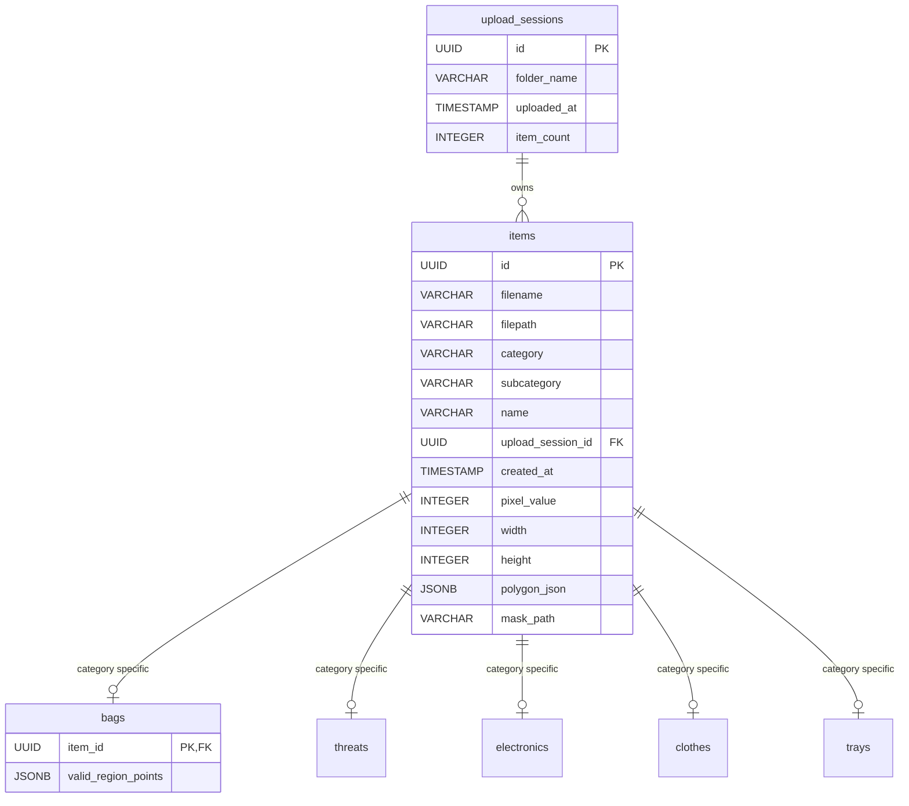

# Synthetic X-Ray Project: Developer & Architecture Guide

Welcome to the technical documentation for the **Synthetic X-Ray Project**. This document serves as a comprehensive resource for any developer working on the codebase, explaining the high-level goals, core technical choices, database designs, folder hierarchies, and offering a file-by-file breakdown of both the frontend and backend.

---

## 1. What We Are Doing in the Project

The core objective of the **Synthetic X-Ray Project** is to generate realistic, simulated X-ray scan images of containers (primarily bags/suitcases) filled with various object categories (clothing, electronics, food, toiletries, etc.), including potentially threat items (firearms, knives, sharp objects). 

These synthetic X-ray scans, accompanied by exact bounding box and pixel-level segmentation coordinate annotations, are used to train machine learning models (such as YOLO or custom segmentation models) for security and baggage scanner screening.

### Key Workflows
1. **File Uploading (`UploadPage`)**: Users upload custom SVG/PNG images of bags or items. These images are categorized (e.g. as a bag, threat, or accessory) and saved under distinct **Upload Sessions**.
2. **Library Management (`LibraryPage`)**: Users browse uploaded and seeded items organized hierarchically by upload session and category. Within this library, users can select a bag and draw its **Valid Placement Region** (a polygonal region representing where items can physically be situated inside the bag).
3. **Collage Creation (`CollagePage`)**: Selected items (bags, threats, accessories) are combined into a collage layout of multiple permutations. The system performs randomized placements ensuring items are located inside the bag's valid region.
4. **Interactive Customization (`CustomizationPage`)**: Users can click any collage permutation to open it in a canvas workspace. They can drag, rotate, scale, bring items to front, send them to back, delete items, and add new ones manually. Security alerts dynamically warn them if a threat is dragged out-of-bounds.
5. **Data Export (`backend/api/export`)**: The final layouts are rendered into high-fidelity composite PNGs mimicking material densities (using the Beer-Lambert law of attenuation) and saved along with JSON annotations defining bounding boxes, segmentations, and metadata.

---

## 2. Project Structure & Technology Choices

The project is structured as a **monorepo** with a separated frontend and backend. 

```
xray1/
├── package.json                   # Root package manager configuration
├── taxonomy.json                  # Master definitions for stencils & category trees
├── backend/                       # Express server, SQLite/Postgres DB handlers, render script
│   ├── src/                       # API routes, rendering code, schemas
│   ├── scripts/                   # Seeding and image organization scripts
│   └── data/                      # File uploads, exported scans, generated collage datasets
└── frontend/                      # React SPA built with Vite & Tailwind CSS
    ├── src/                       # Components, Pages, Utilities, Configs
    └── index.html                 # DOM entry point
```

### Why We Chose This Stack

* **React + TypeScript + Vite (Frontend)**:
  * **React**: Excellent for highly interactive canvas workspaces where single-item states (position, rotation, dimensions, layer index) change continuously during drag-and-drop actions.
  * **TypeScript**: Enforces strict type safety for coordinates, transformations, and database item schemas, reducing runtime errors.
  * **Vite**: Offers instantaneous Hot Module Replacement (HMR) and fast build compile times.
* **Express.js + Node-Canvas (Backend)**:
  * **Express**: Lightweight and easy to write REST APIs for file uploads, database queries, and exporting assets.
  * **Node-Canvas (`canvas` npm module)**: Lets the backend run HTML5 Canvas-like graphics operations natively in Node.js, compiling composite X-ray images on the fly.
* **PostgreSQL Database**:
  * Persistent storage for file metadata, upload session tracking, category taxonomy, and complex structures like the valid region polygons for suitcase items.
* **Beer-Lambert Law Attenuation (Rendering Engine)**:
  * Simulated X-rays combine material colors and alpha values using log-based calculations. Overlapping items become darker rather than simply blending opacity linearly, matching how real X-ray scans behave.

---

## 3. Database Schema

The database resides in a PostgreSQL instance (with default user `postgres` and database `xray_db`), initialized and structured in `backend/src/schema.sql`.



---

## 4. File-by-File Breakdown

### Root Directory

* **[package.json](file:///c:/Users/saikiran/Desktop/xray1/package.json)**
  * Contains scripts to run both the frontend and backend concurrently (`npm run dev:all`), install dependencies in both environments, and initialize packages.
* **[taxonomy.json](file:///c:/Users/saikiran/Desktop/xray1/taxonomy.json)**
  * The master list of categories, subcategories, and predefined stencils. Organizes metadata such as default sizes (`width`, `height`), names, paths, and categories. Used by seed scripts to insert core stencils.
* **[check-taxonomy.js](file:///c:/Users/saikiran/Desktop/xray1/check-taxonomy.js)** / **[reorder-taxonomy.js](file:///c:/Users/saikiran/Desktop/xray1/reorder-taxonomy.js)**
  * Utility scripts in root to validate taxonomy layout, check key definitions, and format JSON structures cleanly.

---

### Backend Components (`backend/`)

#### Source Code (`backend/src/`)

* **[server.js](file:///c:/Users/saikiran/Desktop/xray1/backend/src/server.js)**
  * The main entry point. Sets up Express, static routes for serving uploads and exports `/data`, and exposes endpoints:
    * `/api/upload`: Multi-part upload using `multer` that registers new upload sessions and saves metadata to PostgreSQL.
    * `/api/items/categorized`: Returns all items structured by normalized category/subcategory.
    * `/api/sessions`: Exposes upload sessions and their respective item lists.
    * `/api/export` & `/api/dataset/generate`: Endpoints for single customized saves and batch collage generations.
    * `/api/items/:id/valid-region`: Updates suitcase regions in the database.
* **[schema.sql](file:///c:/Users/saikiran/Desktop/xray1/backend/src/schema.sql)**
  * The DDL statements establishing the database tables, indexing, foreign keys, and default values.

#### Backend Utilities (`backend/src/lib/`)

* **[renderCanvas.js](file:///c:/Users/saikiran/Desktop/xray1/backend/src/lib/renderCanvas.js)**
  * Backend engine utilizing `canvas` to draw scene objects onto an image. It reads SVGs or images recursively from organized subdirectories, renders them, and uses material grayscale densities (`pixel_value`) to simulate X-ray attenuation.
* **[geometry.js](file:///c:/Users/saikiran/Desktop/xray1/backend/src/lib/geometry.js)**
  * Handles backend coordinate geometry. Includes checks like `isObjectInsideContainer` (detects if an item's bounding box fits inside a bag's custom valid region polygon) and random position generation inside suitcases.

#### Backend Business Logic (`backend/src/api/`)

* **[datasetGenerator.js](file:///c:/Users/saikiran/Desktop/xray1/backend/src/api/datasetGenerator.js)**
  * Orchestrates rendering loops for exports. For collages, it shuffles combination layouts, renders them, and outputs YOLO-compatible JSON annotations containing segmentation arrays and bounding boxes.

#### Seeding & Setup Scripts (`backend/scripts/`)

* **[seed-taxonomy.js](file:///c:/Users/saikiran/Desktop/xray1/backend/scripts/seed-taxonomy.js)**
  * Parses `taxonomy.json` and inserts the category hierarchy.
* **[seed-combined-library.js](file:///c:/Users/saikiran/Desktop/xray1/backend/scripts/seed-combined-library.js)**
  * Integrates the custom SVG stencils (drawn inside JavaScript functions) and seeds the PostgreSQL items table with predefined assets.
* **[organize-library-images.js](file:///c:/Users/saikiran/Desktop/xray1/backend/scripts/organize-library-images.js)**
  * Moves SVG files uploaded or seeded into separate organized disk folders under `data/library_images/<category>/<subcategory>/`.
* **[cleanup-empty-dirs.js](file:///c:/Users/saikiran/Desktop/xray1/backend/scripts/cleanup-empty-dirs.js)**
  * Housekeeping script to delete nested empty directories in `library_images`.

---

### Frontend Components (`frontend/`)

#### Global Setup & Core Styles (`frontend/src/`)

* **[main.tsx](file:///c:/Users/saikiran/Desktop/xray1/frontend/src/main.tsx)**
  * Frontend entry point. Mounting React's DOM renderer onto the `#root` element.
* **[App.tsx](file:///c:/Users/saikiran/Desktop/xray1/frontend/src/App.tsx)**
  * Establishes routing and site navigation (`/`, `/library`, `/collage`, `/customize`) inside a navigation wrapper.
* **[index.css](file:///c:/Users/saikiran/Desktop/xray1/frontend/src/index.css)**
  * Custom Vanilla CSS utility tokens combined with Tailwind directives. Enforces custom fonts, animations (`animate-fade-in`, `animate-slide-up`), and unified dark-themed panel states.

#### Configuration (`frontend/src/config/`)

* **[categories.ts](file:///c:/Users/saikiran/Desktop/xray1/frontend/src/config/categories.ts)**
  * Establishes lookups for categories:
    * `CATEGORY_MAP`: Styling rules (backgrounds, border colors, text weights) for categorizing badges.
    * `normalizeCategoryName()`: Normalizes DB keys (e.g. `threat-prohibited-objects` becomes `threats`).
    * `getStencilKind()`: Maps category keywords to basic kinds like `bag`, `threat`, `tray`, or `clothes`.

#### Pages (`frontend/src/pages/`)

* **[UploadPage.tsx](file:///c:/Users/saikiran/Desktop/xray1/frontend/src/pages/UploadPage.tsx)**
  * Interface for dragging and dropping image files, assigning them a session name, managing the queue, and pushing files to the `/api/upload` route.
* **[LibraryPage.tsx](file:///c:/Users/saikiran/Desktop/xray1/frontend/src/pages/LibraryPage.tsx)**
  * Displays the upload session folders and categories. Keeps track of selection sets globally across session boundaries and persistent selections in `localStorage`.
* **[CollagePage.tsx](file:///c:/Users/saikiran/Desktop/xray1/frontend/src/pages/CollagePage.tsx)**
  * Synthesizes and previews generated item combinations. It loads cached choices from `localStorage` on page refresh, and sends generation tasks to the backend.
* **[CustomizationPage.tsx](file:///c:/Users/saikiran/Desktop/xray1/frontend/src/pages/CustomizationPage.tsx)**
  * The full-scale design workspace. Connects user interaction tools: undo/redo, scale adjustments, randomize triggers, dynamic threat-status banners, and localStorage save/restore on refresh.

#### Helper Utilities (`frontend/src/lib/`)

* **[geometry.ts](file:///c:/Users/saikiran/Desktop/xray1/frontend/src/lib/geometry.ts)**
  * Ray-casting algorithms (`isPointInPolygon`) and mathematical polygon projections used by the interactive canvas to detect mouse selection boundaries.
* **[customizationHelpers.ts](file:///c:/Users/saikiran/Desktop/xray1/frontend/src/lib/customizationHelpers.ts)**
  * Coordinates layout calculations:
    * `isObjectInsideContainer()`: Detects whether all corners of an item fit inside the container's valid region.
    * `getRandomPositionInContainer()`: Tries up to 1000 times to place objects inside a container's boundaries safely.
* **[xrayRenderer.ts](file:///c:/Users/saikiran/Desktop/xray1/frontend/src/lib/xrayRenderer.ts)**
  * Composite preview engine for the Collage list. Loads images, caches them, and draws overlaps using X-ray color blends.

#### React Components (`frontend/src/components/`)

##### General Components
* **[HelpMenu.tsx](file:///c:/Users/saikiran/Desktop/xray1/frontend/src/components/HelpMenu.tsx)**
  * Renders interactive tutorials and hotkey summaries.
* **[ValidRegionEditor.tsx](file:///c:/Users/saikiran/Desktop/xray1/frontend/src/components/ValidRegionEditor.tsx)**
  * A powerful canvas-based utility for drawing and editing a bag's valid region polygon. Allows adding points, dragging them, and deleting. Pushes updates to the database.

##### Library Component Tree
* **[LibrarySidebar.tsx](file:///c:/Users/saikiran/Desktop/xray1/frontend/src/components/library/LibrarySidebar.tsx)**
  * Renders the hierarchical tree structure. Organizes categories and subcategories nested cleanly inside upload session folders. Supports bulk select/deselect and deletes.
* **[ItemCard.tsx](file:///c:/Users/saikiran/Desktop/xray1/frontend/src/components/library/ItemCard.tsx)** / **[ItemRow.tsx](file:///c:/Users/saikiran/Desktop/xray1/frontend/src/components/library/ItemRow.tsx)**
  * Presentational rows and grid cards for library assets.
* **[LibraryToolbar.tsx](file:///c:/Users/saikiran/Desktop/xray1/frontend/src/components/library/LibraryToolbar.tsx)**
  * Filter controls, searches, and view toggle buttons.
* **[SelectionTray.tsx](file:///c:/Users/saikiran/Desktop/xray1/frontend/src/components/library/SelectionTray.tsx)**
  * Bottom floating bar tracking selections, preset choices, and collage navigation triggers.

##### Customization Component Tree
* **[CanvasArea.tsx](file:///c:/Users/saikiran/Desktop/xray1/frontend/src/components/customization/CanvasArea.tsx)**
  * The visual canvas workspace where items are rendered as draggable components. Visually draws the container region, guides, and item bounding borders.
* **[WorkspaceToolbar.tsx](file:///c:/Users/saikiran/Desktop/xray1/frontend/src/components/customization/WorkspaceToolbar.tsx)**
  * Top workspace toolbar hosting undo, redo, randomize, layers control, and save.
* **[ScannedBagsSidebar.tsx](file:///c:/Users/saikiran/Desktop/xray1/frontend/src/components/customization/ScannedBagsSidebar.tsx)**
  * Left dock inside customization page that lets users browse and click additional items to inject into their current workspace.

##### Upload Component Tree
* **[UploadConfigPanel.tsx](file:///c:/Users/saikiran/Desktop/xray1/frontend/src/components/upload/UploadConfigPanel.tsx)**
  * Input field for folder/session name.
* **[UploadDropZone.tsx](file:///c:/Users/saikiran/Desktop/xray1/frontend/src/components/upload/UploadDropZone.tsx)**
  * Drag-and-drop trigger zone supporting upload queues.
* **[UploadFileQueue.tsx](file:///c:/Users/saikiran/Desktop/xray1/frontend/src/components/upload/UploadFileQueue.tsx)**
  * Queue list of staged files before uploading.

##### Collage Component Tree
* **[SyntheticPreview.tsx](file:///c:/Users/saikiran/Desktop/xray1/frontend/src/components/collage/SyntheticPreview.tsx)**
  * Preview cards showing the blended composite scans.

---

## 5. Architectural Flow & Key Algorithms

Here is a quick reference for developers on how critical behaviors work inside the codebase.

### Ray-Casting Containment Algorithm
Both frontend and backend rely on the ray-casting algorithm (`isPointInPolygon`) to calculate containment:
```
For each vertex of an object's boundary:
  Draw a horizontal ray from the vertex to infinity.
  Count how many sides of the bag's valid region polygon are intersected by this ray.
  If the intersection count is ODD, the vertex is inside the polygon.
  If EVEN, it is outside.
If all vertices of the object are inside, the object is contained.
```
This is critical for real-time security scanning banners in the workspace and for dataset exports.

---

## 6. How the Designed Images (SVG Stencils) Are Created

### What is the `designed_images` folder?

The `backend/designed_images/` folder (restored by [`restore-designed-images.js`](file:///c:/Users/saikiran/Desktop/xray1/backend/scripts/restore-designed-images.js)) contains **34 hand-coded SVG files** that represent every item type in the system. Each file is a vector graphic that simulates what an object looks like under X-ray illumination — drawn purely using SVG path, rect, circle, and line elements, with carefully chosen `fill-opacity` values to simulate material density.

### File Naming Convention

Every SVG file follows this exact naming pattern:

```
{category}_{subcategory}_{variant}.svg
```

Examples:
| File name | Category | Subcategory | What it represents |
|---|---|---|---|
| `bags_suitcases_hardshell.svg` | bags | suitcases | Hard-shell Suitcase |
| `bags_backpacks_hiking.svg` | bags | backpacks | Hiking Backpack |
| `bags_suitcases_vintage.svg` | bags | suitcases | Vintage Leather Suitcase |
| `threats_firearms_pistol.svg` | threats | firearms | Pistol |
| `threats_knives_knife.svg` | threats | knives | Kitchen Knife |
| `electronics_laptops_laptop.svg` | electronics | laptops | Laptop |
| `clothes_tops_tshirt.svg` | clothes | tops | T-Shirt |
| `food_snacks_energybar.svg` | food | snacks | Energy Bar |

### How the SVG Visually Simulates X-Ray

Each SVG uses black fill (`#000000`) at varying `fill-opacity` values to represent how much a material blocks X-ray radiation:

```svg
<!-- Example: Hard-shell Suitcase (bags_suitcases_hardshell.svg) -->
<svg viewBox="0 0 100 100">
  <!-- Main shell: moderate opacity = moderate density (plastic/metal) -->
  <rect x="5" y="15" width="90" height="70" rx="8"
        fill="#000000" fill-opacity="0.35" stroke="#000000" stroke-width="3" stroke-opacity="0.9"/>
  <!-- Handle: thicker/denser area = higher opacity -->
  <rect x="35" y="5" width="30" height="10" rx="3"
        fill="none" stroke="#000000" stroke-width="2.5" stroke-opacity="0.9"/>
  <!-- Wheels: very dense rubber/metal = high opacity -->
  <circle cx="20" cy="92" r="4" fill="#000000" fill-opacity="0.8"/>
</svg>
```

The opacity logic maps to material density:
- `fill-opacity: 0.10–0.25` → soft organics (food, fabric, paper)
- `fill-opacity: 0.28–0.40` → medium density (plastics, leather)
- `fill-opacity: 0.50–0.70` → hard materials (electronics, metal structures)
- `fill-opacity: 0.75–0.90` → dense metals (gun barrel, knife blade, wheels)

When these SVGs are layered in the rendering engine, the alpha channel becomes the "material thickness map" used in the Beer-Lambert attenuation calculation.

---

## 7. Complete End-to-End Workflow: From Upload to Export

### Step 1 — Upload Page

**What the user does:** Drag one or more image files (from the `designed_images` folder) into the upload drop zone and give the session a name (e.g. "Session 1").

**Frontend code path:**
```
UploadPage.tsx → handleUpload() → FormData.append("images", file) 
→ fetch("POST http://localhost:8080/api/upload", formData)
```

**API called:**
```
POST http://localhost:8080/api/upload
Content-Type: multipart/form-data
Body fields:
  - folderName: "Session 1"
  - images: [file1.svg, file2.svg, ...]
```

**What the backend does (`server.js` lines 319–407):**

1. **Creates a new Upload Session row** in PostgreSQL:
   ```sql
   INSERT INTO upload_sessions (folder_name, uploaded_at, item_count)
   VALUES ('Session 1', NOW(), 3)
   RETURNING *;
   -- Returns: { id: "uuid-v4-here", folder_name: "Session 1", ... }
   ```
   The `id` is a PostgreSQL `UUID` generated by `uuid_generate_v4()`. This becomes the **Session ID** used to group all files uploaded together.

2. **For each file**, `multer` writes it to disk at:
   ```
   backend/data/library_images/{uuid-random}.svg
   ```
   The disk filename is **NOT** the original name — it is a fresh `uuidv4()` generated by multer's `diskStorage.filename`. This avoids collisions if you upload the same file twice.

3. **Taxonomy lookup:** The server checks the original filename (e.g. `bags_suitcases_hardshell.svg`) against the `filenameToItem` Map built from `taxonomy.json`. If matched, it uses the taxonomy's category, subcategory, and name. If not matched, it falls back to filename prefix parsing.

4. **Inserts an Item row** in PostgreSQL:
   ```sql
   INSERT INTO items (filename, filepath, category, subcategory, name, upload_session_id, pixel_value)
   VALUES (
     'bags_suitcases_hardshell.svg',   -- original filename
     '3f2e1a09-...-b44c.svg',          -- multer-generated disk UUID filename
     'bags',
     'suitcases',
     'Hard-shell Suitcase',
     'a8b7c6d5-...',                    -- upload session UUID
     42813                              -- random pixel_value in range for bags
   )
   RETURNING *;
   -- Returns: { id: "item-uuid-here", ... }
   ```

5. **If category is "bags"**, also inserts a row in the `bags` table with `valid_region_points = NULL`:
   ```sql
   INSERT INTO bags (item_id, valid_region_points) VALUES ('item-uuid-here', NULL);
   ```

**Response JSON:**
```json
{
  "ok": true,
  "message": "Files uploaded successfully!",
  "uploadSessionId": "a8b7c6d5-...",
  "itemsProcessed": 3
}
```

---

### Step 2 — Library Page: Browsing & Valid Region Drawing

**What the user sees:** All uploaded sessions listed in a sidebar. Clicking a session and category shows item cards. Bags show a pencil icon for drawing the valid region.

#### 2a. Fetching Sessions and Items

**APIs called on Library page mount:**
```
GET http://localhost:8080/api/sessions
GET http://localhost:8080/api/items/categorized
GET http://localhost:8080/api/taxonomy
```

`GET /api/sessions` returns:
```json
{
  "ok": true,
  "sessions": [
    {
      "id": "a8b7c6d5-...",
      "folder_name": "Session 1",
      "uploaded_at": "2026-06-11T18:00:00Z",
      "item_count": 3,
      "items": [
        {
          "id": "item-uuid-1",
          "filename": "bags_suitcases_hardshell.svg",
          "filepath": "3f2e1a09-...-b44c.svg",
          "category": "bags",
          "subcategory": "suitcases",
          "name": "Hard-shell Suitcase",
          "pixel_value": 42813,
          "valid_region_points": null
        }
      ]
    }
  ]
}
```

#### 2b. Opening the Valid Region Editor

When the user clicks the pencil icon on a bag card, the frontend first fetches the full item details:
```
GET http://localhost:8080/api/items/{item-uuid-1}
```
Response adds `validRegionData` if a region was previously saved, or null if not.

The `ValidRegionEditor` component opens as a full-screen overlay. It renders the bag's actual SVG image onto a `<canvas>` element scaled to fill the screen, then lets the user:
- Draw rectangle, circle, or freeform polygon shapes over the bag interior
- Mark shapes as "additive" (include region) or "subtractive" (cut-out region)
- Move, resize, and delete shapes
- Undo/redo via internal history

#### 2c. What the Valid Region Coordinates Mean

All coordinates saved by the `ValidRegionEditor` are stored as **normalized fractions** in the range `[0.0 → 1.0]` relative to the image dimensions. For example, a point at `{x: 0.5, y: 0.3}` means "50% of image width, 30% of image height."

Internally, the editor computes a `simplifiedPoints` array: a flattened polygon approximation of all the additive/subtractive shapes combined. This is the set of normalized vertex coordinates that the geometry engine actually uses for placement decisions.

**Mathematical conversion when editor is drawn:**
```
canvas_x = (canvas_width * zoom) × normalized_x + panOffset.x
canvas_y = (canvas_height * zoom) × normalized_y + panOffset.y
```
**Saved to DB as normalized:**
```
normalized_x = (canvas_x - panOffset.x) / (canvas_width × zoom)
normalized_y = (canvas_y - panOffset.y) / (canvas_height × zoom)
```

#### 2d. Saving the Valid Region to the Database

When the user clicks "Save" in the editor:

**Frontend call (`LibraryPage.tsx → saveValidRegion()`):**
```
PUT http://localhost:8080/api/items/{item-uuid}/valid-region
Content-Type: application/json
Body:
{
  "validRegionPoints": [
    {"x": 0.12, "y": 0.18},
    {"x": 0.88, "y": 0.18},
    {"x": 0.88, "y": 0.92},
    {"x": 0.12, "y": 0.92}
  ],
  "shapes": [
    {
      "id": "shape-uuid",
      "type": "rectangle",
      "isPositive": true,
      "x": 0.12, "y": 0.18,
      "width": 0.76, "height": 0.74,
      ...
    }
  ]
}
```

**Backend SQL (`server.js` line 469):**
```sql
UPDATE bags
SET valid_region_points = '{
  "shapes": [...],
  "simplifiedPoints": [{"x":0.12,"y":0.18}, ...],
  "version": 2
}'::jsonb
WHERE item_id = 'item-uuid-1';
```

The DB stores a **JSONB object with three keys**:
- `shapes` → full shape data for re-editing (the complete editor state)
- `simplifiedPoints` → the polygon vertex array used for collision math
- `version: 2` → schema version for backward compatibility

**Why normalized coordinates?** Because the bag SVG will be rendered at different sizes at different times (e.g., 70% of canvas in Customization, 75% in dataset export). By storing fractions instead of pixels, the same region polygon scales correctly to any canvas resolution without re-saving.

**After saving**, the frontend calls:
```
GET /api/sessions        ← refresh sessions (stale valid_region_points fix)
GET /api/items/categorized  ← refresh categorized items
```
Both run in parallel via `Promise.all(...)` so the valid region check in `toggleItemSelection()` immediately sees the saved data.

---

### Step 3 — Selecting Items and Generating a Collage

**What the user does:** Check items in the Library (bags, threats, other items), then click "Generate Collage." The system enforces that every selected bag must have a valid region drawn.

**Frontend check in `toggleItemSelection()` (`LibraryPage.tsx`):**
```typescript
// Look up fresh data from categorizedItems (updated after saveValidRegion)
const vrp = item.valid_region_points;
const hasValidRegion = vrp &&
  (Array.isArray(vrp) ? vrp.length > 0 : Object.keys(vrp).length > 0);

if (isBag && !hasValidRegion) {
  showNotification("warning", `Please draw the valid region...`);
  return; // Block selection
}
```

**Selection state persistence:** All selected item IDs, the full item objects (bags/threats/others), and the `densityPreset` are saved to `localStorage` keys:
- `selectedItemIds` → `Set<UUID>` serialized as JSON array
- `selectedBags`, `selectedThreats`, `selectedOthers` → full Item objects
- `densityPreset` → `"empty"` | `"few"` | `"filled"`

**Navigation to Collage page:**
```typescript
navigate("/collage", {
  state: { selectedBags, selectedThreats, selectedOthers, densityPreset }
});
```

**No API is called at this step** — it's pure in-memory + localStorage state passing via React Router location state.

---

### Step 4 — Collage Page: Viewing Combinations

The Collage page renders all permutations of (bag × threat × others). It doesn't call any write APIs at this stage — it only reads from React Router state (or `localStorage` on refresh).

**Combinations generated (pure frontend logic, `CollagePage.tsx`):**
```
For each selected bag:
  Combination 1: bag + others (no threat) → "clean scan"
  For each selected threat:
    Combination 2: bag + threat + others → "threat scan"
```

Each `SyntheticPreview` card renders the combination using the **frontend X-ray renderer** (`xrayRenderer.ts`) — a pure browser Canvas API preview (no backend call).

**No APIs are called** until the user clicks "Export Dataset."

---

### Step 5 — Customization Page: Interactive Canvas Workspace

When a user clicks a collage preview card, they navigate to:
```
/customize?bagId={uuid}&threatId={uuid}&otherIds={uuid1,uuid2,...}
```

**API called on mount:**
```
GET http://localhost:8080/api/items/categorized
```
This gives the full item library so the customization page can build the initial scene and populate the sidebar.

**Scene building (`buildAndSetObjects()` in `CustomizationPage.tsx`):**
- Bag: placed at canvas center `(400, 300)`, size = 70% of 800×600 canvas
- Other items: placed at **50% of their original image size** (`item.width × 0.5`)
- Threats: placed at **50% of their original image size**
- All non-bag items placed via `getRandomPositionInContainer()` (see geometry math below)

**What operations are available:**

| Action | Mechanism |
|---|---|
| Drag item | `onMouseDown` → `onMouseMove` → tracks `e.clientX - dragStart.x` |
| Rotate item | `onMouseDown` (rotation handle) → `Math.atan2(mouseY - centerY, mouseX - centerX)` |
| Scale item | Resize handles via `onMouseDown` on corner handles |
| Undo/Redo | Push/pop `history[]` array of full `SceneObject[]` snapshots |
| Add item | Click item in sidebar → `handleAddObject()` → placed inside bag via `getRandomPositionInContainer()` |
| Delete | Selected item removed from `objects[]` |
| Layer up/down | Swap `layer` integer values between adjacent objects |
| Bring to front | Set `layer = maxLayer + 1` |
| Send to back | Set `layer = -1` |
| Randomize | Clear localStorage for this combo key, call `buildAndSetObjects()` again |

**Real-time threat status banner** is computed on every render:
```typescript
const isThreatInside = isObjectInsideContainer(threatObj, bagObject);
// → "SCAN RESULT: CLEAN" / "THREAT PRESENT & SECURED" / "SECURITY ALERT: THREAT OUT OF BOUNDS"
```

**Workspace persistence to localStorage** (so page refresh doesn't lose positions):
```
key: xray_workspace_{bagId}_{threatId}_{otherIds}
value: JSON.stringify(objects[])  // Full SceneObject array
```

---

### Step 6 — Saving the Customization Export

When the user clicks "Save" in the customization workspace:

**API called:**
```
POST http://localhost:8080/api/export
Content-Type: application/json
Body:
{
  "prototype": "synthetic-xray-customization",
  "objects": [
    {
      "id": "initial-bag",
      "name": "Hard-shell Suitcase",
      "library": "bag",
      "originalPixelValue": 42813,
      "currentPixelValue": 42813,
      "filepath": "3f2e1a09-...-b44c.svg",
      "polygonOutline": [{"x":0.12,"y":0.18}, ...],
      "transform": {"x": 400, "y": 300, "width": 560, "height": 420, "rotation": 0},
      "layer": 0,
      "segmentation": [{"x":120,"y":90}, {"x":680,"y":90}, ...]
    },
    { "id": "initial-threat", "name": "Pistol", "library": "threat", ... }
  ],
  "validRegionPolygon": [{"x":134,"y":108}, ...],
  "annotationSchema": "per-object-segmentation"
}
```

**Backend saves to disk** at `backend/data/exports/synth-{timestamp}/`:
```
synth-2026-06-11T18-30-00-000Z/
  ├── metadata.json     ← full scene annotation with threat status
  ├── summary.txt       ← human-readable summary
  ├── images/
  │   └── synth-2026-06-11T18-30-00-000Z.png  ← rendered X-ray PNG
  └── labels/
      └── synth-2026-06-11T18-30-00-000Z.json ← YOLO-format annotations
```

The PNG is rendered by `renderSceneAsync()` using the Beer-Lambert engine (see Section 8).

---

### Step 7 — Batch Dataset Export (from Collage Page)

When the user clicks "Export Dataset" on the Collage page:

**API called:**
```
POST http://localhost:8080/api/dataset/generate
Content-Type: application/json
Body:
{
  "combinations": [
    {
      "id": "item-uuid-bag-clean",
      "bag": { Item object with valid_region_points, filepath, pixel_value, ... },
      "threat": null,
      "others": [ Item, Item, ... ]
    },
    {
      "id": "item-uuid-bag-threat",
      "bag": { ... },
      "threat": { Item object },
      "others": [ ... ]
    }
  ],
  "resolutionWidth": 800,
  "resolutionHeight": 600
}
```

**Backend (`datasetGenerator.js`) for each combination:**
1. Reconstructs a fresh random scene layout (bag centered, items placed inside valid region)
2. Calls `renderSceneAsync()` → PNG buffer
3. Writes `images/{comboId}.png`
4. Computes bounding boxes + segmentation polygons for each object
5. Writes `labels/{comboId}.json`

**Saved to disk** at `backend/data/collage_images/dataset-{timestamp}/`:
```
dataset-2026-06-11T23-57-11-119Z/
  ├── manifest.json
  ├── images/
  │   ├── {bag-uuid}-clean.png
  │   └── {bag-uuid}-{threat-uuid}.png
  └── labels/
      ├── {bag-uuid}-clean.json
      └── {bag-uuid}-{threat-uuid}.json
```

Each label JSON follows this structure:
```json
{
  "image_id": "7e73f57f-...-2873095f",
  "filename": "7e73f57f-...-2873095f.png",
  "width": 800, "height": 600,
  "has_threat": true,
  "threat_status": "threat_present",
  "placement_validity": "valid",
  "bag": { "id": "...", "name": "Hard-shell Suitcase", "filepath": "..." },
  "objects": [
    {
      "id": "bag-item-uuid",
      "name": "Hard-shell Suitcase",
      "category": "bags",
      "pixel_value": 42813,
      "transform": { "x": 400, "y": 300, "width": 600, "height": 450, "rotation": 0 },
      "layer": 0,
      "bbox": { "x": 100, "y": 75, "width": 600, "height": 450 },
      "segmentation": [{"x":100,"y":75},{"x":700,"y":75},{"x":700,"y":525},{"x":100,"y":525}]
    }
  ]
}
```

---

## 8. Pixel Value Physics: The Beer-Lambert Attenuation Model

### What is a `pixel_value`?

Every item in the database has an integer `pixel_value` in the range **0 – 65535** (16-bit unsigned). This represents how much X-ray radiation the material transmits:

| pixel_value range | Material type | Example |
|---|---|---|
| 0 – 5 000 | Near-opaque / dense metal | Lead, steel |
| 5 000 – 20 000 | Dense metal / hard electronics | Gun barrel, knife, circuit boards |
| 15 000 – 35 000 | Medium density / plastics | Laptop casing, phone, charger |
| 30 000 – 45 000 | Low-medium / organic material | Food, clothing, leather bags |
| 45 000 – 60 000 | Light / soft material | Paper, foam, fabric |
| 60 000 – 65 535 | Air / near-transparent | Empty space |

Bags default to `42 000 – 52 000` (leather/plastic). Threats default to `10 000 – 20 000` (metal). Electronics are `15 000 – 30 000`.

---

### Step 1: Attenuation Coefficient Calculation

For each scene object, the linear attenuation coefficient `μ` (mu) is computed from its `pixel_value`:

```
μ = -ln( pixel_value / 65535 )
```

This formula is derived from the Beer-Lambert Law of radiation attenuation:

```
I = I₀ × e^(-μ × t)
```

where:
- `I₀` = initial X-ray intensity = `65535` (maximum, full beam)
- `I` = transmitted intensity = `pixel_value` (what passes through)
- `t` = material thickness (we normalize this to `[0, 1]` using the alpha channel)
- `μ` = attenuation coefficient (how strongly the material blocks X-rays)

Rearranging for μ:
```
μ = -ln(I/I₀) = -ln(pixel_value / 65535)
```

Example values:
```
Gun barrel (pixel_value = 8000):  μ = -ln(8000/65535) = 2.1
Laptop bag (pixel_value = 42000): μ = -ln(42000/65535) = 0.45
Knife      (pixel_value = 12000): μ = -ln(12000/65535) = 1.70
```

Higher μ = more X-ray blocking = darker in the final image.

---

### Step 2: Alpha Channel as Thickness Map

Each SVG is rendered onto an offscreen canvas. The **alpha channel value** of each pixel tells us how thick that part of the material is at that point. Since SVG uses `fill-opacity`, pixels at the edges or near semi-transparent areas have lower alpha than the solid center:

```
normalized_thickness(pixel) = alpha_value / 255
```

Where `alpha_value` ranges from 0 (transparent, no material) to 255 (fully opaque, maximum thickness).

---

### Step 3: Density Buffer Accumulation

A `Float32Array densityBuffer[width × height]` accumulates the total optical depth across all layers:

```
For each object (sorted by layer, lowest first):
  Render the SVG onto an offscreen canvas
  For each pixel (x, y):
    thickness = alpha[x,y] / 255
    densityBuffer[x,y] += μ_object × thickness
```

This is the key physical insight: **overlapping materials add their attenuations**. A gun inside a bag at pixel (300, 200) contributes both the bag's μ and the gun's μ to `densityBuffer[300,200]`.

---

### Step 4: Final Intensity Conversion

Once all objects are accumulated, the density buffer is converted back to an 8-bit grayscale image:

```
For each pixel (x, y):
  total_density = densityBuffer[x,y]
  intensity_16bit = 65535 × e^(-total_density)
  grayscale_8bit = round( (intensity_16bit / 65535) × 255 )
  final_pixel = RGB(grayscale_8bit, grayscale_8bit, grayscale_8bit)
```

Example at a pixel where a gun overlaps a bag:
```
μ_bag  = 0.45  (pixel_value = 42000)
μ_gun  = 2.10  (pixel_value = 8000)
thickness_bag = 0.35  (from SVG alpha at that point)
thickness_gun = 0.90  (from SVG alpha at that point)

density = (0.45 × 0.35) + (2.10 × 0.90)
        = 0.1575 + 1.89
        = 2.047

intensity = 65535 × e^(-2.047)
          = 65535 × 0.129
          = 8461  (16-bit)

grayscale = round((8461 / 65535) × 255)
          = round(32.9)
          = 33   ← very dark grey, simulating a dense metal object

```

A pixel with no material stays at 65535 → 255 (pure white, no attenuation).

---

### Step 5: Frontend Preview vs Backend Render

The **same Beer-Lambert algorithm** runs in two places:

| Location | File | When used | Output |
|---|---|---|---|
| **Frontend** | `xrayRenderer.ts` | Live preview in Collage and Customization | Browser Canvas pixels (8-bit) |
| **Backend** | `renderCanvas.js` | Dataset export / save | PNG file (8-bit grayscale) |

Both implementations follow the exact same steps. The frontend version uses `HTMLCanvasElement` and `getImageData`. The backend uses the `canvas` npm package which provides the same API in Node.js.

---

### Frontend Pixel Value Adjustment (Overlap Detection)

In the Customization workspace, the frontend also computes a **simplified pixel value adjustment** for overlapping items (`calculatePixelValues()` in `customizationHelpers.ts`):

```typescript
// For object A overlapping object B (B is below A in layer order):
newPixelValue = Math.round((A.originalPixelValue × B.currentPixelValue) / 65535)
```

This is a multiplicative blending formula: when two materials overlap, the transmitted intensity is the product of both individual transmittances. This drives the on-screen pixel value readout shown in the toolbar when an item is selected.

Example:
```
Laptop (pixel_value = 25000) placed on top of Bag (pixel_value = 42000):
adjusted = (25000 × 42000) / 65535 = 16,014
```
The laptop appears darker because the bag's material adds additional attenuation behind it.

---

## 9. How Uniqueness is Maintained Across the System

| Entity | Unique Key | Generated by |
|---|---|---|
| Upload Session | `upload_sessions.id` UUID | PostgreSQL `uuid_generate_v4()` |
| Item on disk | `items.filepath` (multer UUID filename) | Node.js `uuidv4()` in multer storage |
| Item in DB | `items.id` UUID | PostgreSQL `uuid_generate_v4()` |
| Bag valid region | `bags.item_id` (FK to items.id) | Inherited from item UUID — one-to-one |
| Export on disk | `synth-{ISO-timestamp}` folder name | `safeNowStamp()` in server.js |
| Dataset on disk | `dataset-{ISO-timestamp}` folder name | `safeNowStamp()` in server.js |
| Scene object in workspace | `custom-object-{Date.now()}` | Frontend `Date.now()` |

**Sessions never mix items:** Each upload creates exactly one `upload_sessions` row, and every `items` row has a `upload_session_id` foreign key. The cascade delete (`ON DELETE CASCADE`) means deleting a session automatically deletes all its items from both `items` and `bags`/`threats`/etc. tables.

**File collision prevention:** Even if you upload `bags_suitcases_hardshell.svg` three times across three sessions, each gets a different UUID disk filename (e.g. `3f2e1a09.svg`, `99a7bc12.svg`, `f40d11e3.svg`) while preserving the original `filename` column in `items` for display.

