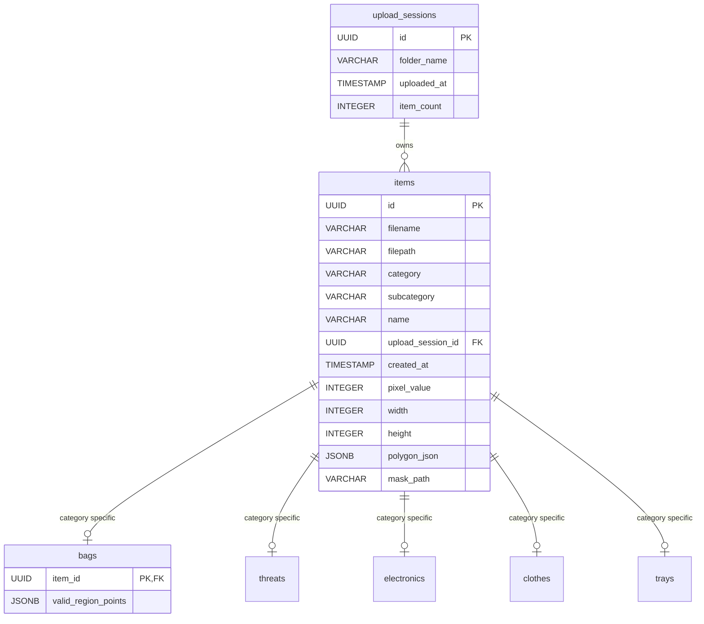

# Synthetic X-Ray Project: Developer & Architecture Guide

Welcome to the technical documentation for the **Synthetic X-Ray Project**. This document serves as a comprehensive resource for any developer working on the codebase, explaining the high-level goals, core technical choices, database designs, folder hierarchies, and offering a file-by-file breakdown of both the frontend and backend.

---

## 1. What We Are Doing in the Project

The core objective of the **Synthetic X-Ray Project** is to generate realistic, simulated X-ray scan images of containers (primarily bags/suitcases) filled with various object categories (clothing, electronics, food, toiletries, etc.), including potentially threat items (firearms, knives, sharp objects). 

These synthetic X-ray scans, accompanied by exact bounding box and pixel-level segmentation coordinate annotations, are used to train machine learning models (such as YOLO or custom segmentation models) for security and baggage scanner screening.

### Key Workflows
1. **File Uploading (`UploadPage`)**: Users upload custom SVG/PNG images of bags or items. These images are categorized (e.g. as a bag, threat, or accessory) and saved under distinct **Upload Sessions**.
2. **Library Management (`LibraryPage`)**: Users browse uploaded and seeded items organized hierarchically by upload session and category. Within this library, users can select a bag and draw its **Valid Placement Region** (a polygonal region representing where items can physically be situated inside the bag).
3. **Collage Creation (`CollagePage`)**: Selected items (bags, threats, accessories) are combined into a collage layout of multiple permutations. The system performs randomized placements ensuring items are located inside the bag's valid region.
4. **Interactive Customization (`CustomizationPage`)**: Users can click any collage permutation to open it in a canvas workspace. They can drag, rotate, scale, bring items to front, send them to back, delete items, and add new ones manually. Security alerts dynamically warn them if a threat is dragged out-of-bounds.
5. **Data Export (`backend/api/export`)**: The final layouts are rendered into high-fidelity composite PNGs mimicking material densities (using the Beer-Lambert law of attenuation) and saved along with JSON annotations defining bounding boxes, segmentations, and metadata.

---

## 2. Project Structure & Technology Choices

The project is structured as a **monorepo** with a separated frontend and backend. 

```
xray1/
├── package.json                   # Root package manager configuration
├── taxonomy.json                  # Master definitions for stencils & category trees
├── backend/                       # Express server, SQLite/Postgres DB handlers, render script
│   ├── src/                       # API routes, rendering code, schemas
│   ├── scripts/                   # Seeding and image organization scripts
│   └── data/                      # File uploads, exported scans, generated collage datasets
└── frontend/                      # React SPA built with Vite & Tailwind CSS
    ├── src/                       # Components, Pages, Utilities, Configs
    └── index.html                 # DOM entry point
```

### Why We Chose This Stack

* **React + TypeScript + Vite (Frontend)**:
  * **React**: Excellent for highly interactive canvas workspaces where single-item states (position, rotation, dimensions, layer index) change continuously during drag-and-drop actions.
  * **TypeScript**: Enforces strict type safety for coordinates, transformations, and database item schemas, reducing runtime errors.
  * **Vite**: Offers instantaneous Hot Module Replacement (HMR) and fast build compile times.
* **Express.js + Node-Canvas (Backend)**:
  * **Express**: Lightweight and easy to write REST APIs for file uploads, database queries, and exporting assets.
  * **Node-Canvas (`canvas` npm module)**: Lets the backend run HTML5 Canvas-like graphics operations natively in Node.js, compiling composite X-ray images on the fly.
* **PostgreSQL Database**:
  * Persistent storage for file metadata, upload session tracking, category taxonomy, and complex structures like the valid region polygons for suitcase items.
* **Beer-Lambert Law Attenuation (Rendering Engine)**:
  * Simulated X-rays combine material colors and alpha values using log-based calculations. Overlapping items become darker rather than simply blending opacity linearly, matching how real X-ray scans behave.

---

## 3. Database Schema

The database resides in a PostgreSQL instance (with default user `postgres` and database `xray_db`), initialized and structured in `backend/src/schema.sql`.



---

## 4. File-by-File Breakdown

### Root Directory

* **[package.json](file:///c:/Users/saikiran/Desktop/xray1/package.json)**
  * Contains scripts to run both the frontend and backend concurrently (`npm run dev:all`), install dependencies in both environments, and initialize packages.
* **[taxonomy.json](file:///c:/Users/saikiran/Desktop/xray1/taxonomy.json)**
  * The master list of categories, subcategories, and predefined stencils. Organizes metadata such as default sizes (`width`, `height`), names, paths, and categories. Used by seed scripts to insert core stencils.
* **[check-taxonomy.js](file:///c:/Users/saikiran/Desktop/xray1/check-taxonomy.js)** / **[reorder-taxonomy.js](file:///c:/Users/saikiran/Desktop/xray1/reorder-taxonomy.js)**
  * Utility scripts in root to validate taxonomy layout, check key definitions, and format JSON structures cleanly.

---

### Backend Components (`backend/`)

#### Source Code (`backend/src/`)

* **[server.js](file:///c:/Users/saikiran/Desktop/xray1/backend/src/server.js)**
  * The main entry point. Sets up Express, static routes for serving uploads and exports `/data`, and exposes endpoints:
    * `/api/upload`: Multi-part upload using `multer` that registers new upload sessions and saves metadata to PostgreSQL.
    * `/api/items/categorized`: Returns all items structured by normalized category/subcategory.
    * `/api/sessions`: Exposes upload sessions and their respective item lists.
    * `/api/export` & `/api/dataset/generate`: Endpoints for single customized saves and batch collage generations.
    * `/api/items/:id/valid-region`: Updates suitcase regions in the database.
* **[schema.sql](file:///c:/Users/saikiran/Desktop/xray1/backend/src/schema.sql)**
  * The DDL statements establishing the database tables, indexing, foreign keys, and default values.

#### Backend Utilities (`backend/src/lib/`)

* **[renderCanvas.js](file:///c:/Users/saikiran/Desktop/xray1/backend/src/lib/renderCanvas.js)**
  * Backend engine utilizing `canvas` to draw scene objects onto an image. It reads SVGs or images recursively from organized subdirectories, renders them, and uses material grayscale densities (`pixel_value`) to simulate X-ray attenuation.
* **[geometry.js](file:///c:/Users/saikiran/Desktop/xray1/backend/src/lib/geometry.js)**
  * Handles backend coordinate geometry. Includes checks like `isObjectInsideContainer` (detects if an item's bounding box fits inside a bag's custom valid region polygon) and random position generation inside suitcases.

#### Backend Business Logic (`backend/src/api/`)

* **[datasetGenerator.js](file:///c:/Users/saikiran/Desktop/xray1/backend/src/api/datasetGenerator.js)**
  * Orchestrates rendering loops for exports. For collages, it shuffles combination layouts, renders them, and outputs YOLO-compatible JSON annotations containing segmentation arrays and bounding boxes.

#### Seeding & Setup Scripts (`backend/scripts/`)

* **[seed-taxonomy.js](file:///c:/Users/saikiran/Desktop/xray1/backend/scripts/seed-taxonomy.js)**
  * Parses `taxonomy.json` and inserts the category hierarchy.
* **[seed-combined-library.js](file:///c:/Users/saikiran/Desktop/xray1/backend/scripts/seed-combined-library.js)**
  * Integrates the custom SVG stencils (drawn inside JavaScript functions) and seeds the PostgreSQL items table with predefined assets.
* **[organize-library-images.js](file:///c:/Users/saikiran/Desktop/xray1/backend/scripts/organize-library-images.js)**
  * Moves SVG files uploaded or seeded into separate organized disk folders under `data/library_images/<category>/<subcategory>/`.
* **[cleanup-empty-dirs.js](file:///c:/Users/saikiran/Desktop/xray1/backend/scripts/cleanup-empty-dirs.js)**
  * Housekeeping script to delete nested empty directories in `library_images`.

---

### Frontend Components (`frontend/`)

#### Global Setup & Core Styles (`frontend/src/`)

* **[main.tsx](file:///c:/Users/saikiran/Desktop/xray1/frontend/src/main.tsx)**
  * Frontend entry point. Mounting React's DOM renderer onto the `#root` element.
* **[App.tsx](file:///c:/Users/saikiran/Desktop/xray1/frontend/src/App.tsx)**
  * Establishes routing and site navigation (`/`, `/library`, `/collage`, `/customize`) inside a navigation wrapper.
* **[index.css](file:///c:/Users/saikiran/Desktop/xray1/frontend/src/index.css)**
  * Custom Vanilla CSS utility tokens combined with Tailwind directives. Enforces custom fonts, animations (`animate-fade-in`, `animate-slide-up`), and unified dark-themed panel states.

#### Configuration (`frontend/src/config/`)

* **[categories.ts](file:///c:/Users/saikiran/Desktop/xray1/frontend/src/config/categories.ts)**
  * Establishes lookups for categories:
    * `CATEGORY_MAP`: Styling rules (backgrounds, border colors, text weights) for categorizing badges.
    * `normalizeCategoryName()`: Normalizes DB keys (e.g. `threat-prohibited-objects` becomes `threats`).
    * `getStencilKind()`: Maps category keywords to basic kinds like `bag`, `threat`, `tray`, or `clothes`.

#### Pages (`frontend/src/pages/`)

* **[UploadPage.tsx](file:///c:/Users/saikiran/Desktop/xray1/frontend/src/pages/UploadPage.tsx)**
  * Interface for dragging and dropping image files, assigning them a session name, managing the queue, and pushing files to the `/api/upload` route.
* **[LibraryPage.tsx](file:///c:/Users/saikiran/Desktop/xray1/frontend/src/pages/LibraryPage.tsx)**
  * Displays the upload session folders and categories. Keeps track of selection sets globally across session boundaries and persistent selections in `localStorage`.
* **[CollagePage.tsx](file:///c:/Users/saikiran/Desktop/xray1/frontend/src/pages/CollagePage.tsx)**
  * Synthesizes and previews generated item combinations. It loads cached choices from `localStorage` on page refresh, and sends generation tasks to the backend.
* **[CustomizationPage.tsx](file:///c:/Users/saikiran/Desktop/xray1/frontend/src/pages/CustomizationPage.tsx)**
  * The full-scale design workspace. Connects user interaction tools: undo/redo, scale adjustments, randomize triggers, dynamic threat-status banners, and localStorage save/restore on refresh.

#### Helper Utilities (`frontend/src/lib/`)

* **[geometry.ts](file:///c:/Users/saikiran/Desktop/xray1/frontend/src/lib/geometry.ts)**
  * Ray-casting algorithms (`isPointInPolygon`) and mathematical polygon projections used by the interactive canvas to detect mouse selection boundaries.
* **[customizationHelpers.ts](file:///c:/Users/saikiran/Desktop/xray1/frontend/src/lib/customizationHelpers.ts)**
  * Coordinates layout calculations:
    * `isObjectInsideContainer()`: Detects whether all corners of an item fit inside the container's valid region.
    * `getRandomPositionInContainer()`: Tries up to 1000 times to place objects inside a container's boundaries safely.
* **[xrayRenderer.ts](file:///c:/Users/saikiran/Desktop/xray1/frontend/src/lib/xrayRenderer.ts)**
  * Composite preview engine for the Collage list. Loads images, caches them, and draws overlaps using X-ray color blends.

#### React Components (`frontend/src/components/`)

##### General Components
* **[HelpMenu.tsx](file:///c:/Users/saikiran/Desktop/xray1/frontend/src/components/HelpMenu.tsx)**
  * Renders interactive tutorials and hotkey summaries.
* **[ValidRegionEditor.tsx](file:///c:/Users/saikiran/Desktop/xray1/frontend/src/components/ValidRegionEditor.tsx)**
  * A powerful canvas-based utility for drawing and editing a bag's valid region polygon. Allows adding points, dragging them, and deleting. Pushes updates to the database.

##### Library Component Tree
* **[LibrarySidebar.tsx](file:///c:/Users/saikiran/Desktop/xray1/frontend/src/components/library/LibrarySidebar.tsx)**
  * Renders the hierarchical tree structure. Organizes categories and subcategories nested cleanly inside upload session folders. Supports bulk select/deselect and deletes.
* **[ItemCard.tsx](file:///c:/Users/saikiran/Desktop/xray1/frontend/src/components/library/ItemCard.tsx)** / **[ItemRow.tsx](file:///c:/Users/saikiran/Desktop/xray1/frontend/src/components/library/ItemRow.tsx)**
  * Presentational rows and grid cards for library assets.
* **[LibraryToolbar.tsx](file:///c:/Users/saikiran/Desktop/xray1/frontend/src/components/library/LibraryToolbar.tsx)**
  * Filter controls, searches, and view toggle buttons.
* **[SelectionTray.tsx](file:///c:/Users/saikiran/Desktop/xray1/frontend/src/components/library/SelectionTray.tsx)**
  * Bottom floating bar tracking selections, preset choices, and collage navigation triggers.

##### Customization Component Tree
* **[CanvasArea.tsx](file:///c:/Users/saikiran/Desktop/xray1/frontend/src/components/customization/CanvasArea.tsx)**
  * The visual canvas workspace where items are rendered as draggable components. Visually draws the container region, guides, and item bounding borders.
* **[WorkspaceToolbar.tsx](file:///c:/Users/saikiran/Desktop/xray1/frontend/src/components/customization/WorkspaceToolbar.tsx)**
  * Top workspace toolbar hosting undo, redo, randomize, layers control, and save.
* **[ScannedBagsSidebar.tsx](file:///c:/Users/saikiran/Desktop/xray1/frontend/src/components/customization/ScannedBagsSidebar.tsx)**
  * Left dock inside customization page that lets users browse and click additional items to inject into their current workspace.

##### Upload Component Tree
* **[UploadConfigPanel.tsx](file:///c:/Users/saikiran/Desktop/xray1/frontend/src/components/upload/UploadConfigPanel.tsx)**
  * Input field for folder/session name.
* **[UploadDropZone.tsx](file:///c:/Users/saikiran/Desktop/xray1/frontend/src/components/upload/UploadDropZone.tsx)**
  * Drag-and-drop trigger zone supporting upload queues.
* **[UploadFileQueue.tsx](file:///c:/Users/saikiran/Desktop/xray1/frontend/src/components/upload/UploadFileQueue.tsx)**
  * Queue list of staged files before uploading.

##### Collage Component Tree
* **[SyntheticPreview.tsx](file:///c:/Users/saikiran/Desktop/xray1/frontend/src/components/collage/SyntheticPreview.tsx)**
  * Preview cards showing the blended composite scans.

---

## 5. Architectural Flow & Key Algorithms

Here is a quick reference for developers on how critical behaviors work inside the codebase.

### Ray-Casting Containment Algorithm
Both frontend and backend rely on the ray-casting algorithm (`isPointInPolygon`) to calculate containment:
```
For each vertex of an object's boundary:
  Draw a horizontal ray from the vertex to infinity.
  Count how many sides of the bag's valid region polygon are intersected by this ray.
  If the intersection count is ODD, the vertex is inside the polygon.
  If EVEN, it is outside.
If all vertices of the object are inside, the object is contained.
```
This is critical for real-time security scanning banners in the workspace and for dataset exports.
