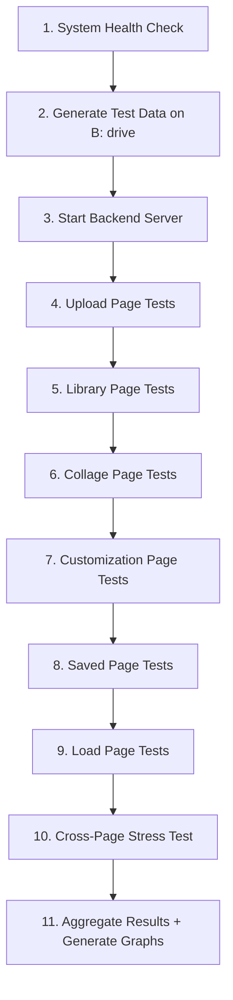

# Comprehensive Load Test Plan — Synthetic X-Ray Application

> **Date:** 2026-10-24  
> **System Under Test:** Synthetic X-Ray Bag Scan Generation System  
> **Test Environment:** Local laptop

---

## 1. System Specifications

| Component | Value |
|-----------|-------|
| **OS** | Windows 11 Home (Build 26200) |
| **CPU** | Intel Core i5-12450HX, 8 cores / 12 logical processors |
| **RAM** | 16,092 MB total (~16 GB) |
| **Available RAM** | ~1,143 MB (at baseline, memory-constrained) |
| **B: Drive** | 31.51 GB free (project drive) |
| **C: Drive** | 1.36 GB free (**critically low**) |
| **Architecture** | x64 |

> [!WARNING]
> Local laptop testing was constrained by disk space (~4 GB free) and available RAM (~1.1 GB). The load testing suite has been professionalized and ported for execution on the **Lab Linux Workstation**.

---

## 1.1 Lab Linux Computer Execution Strategy

To achieve reliable high-volume stress testing (10,000 → 20,000+ files) without filling workstation drives, the testing engine utilizes a **Seed-Looping In-Memory Architecture**:

1. **System Auto-Profiling:**
   - Script: `load_test/scripts/extract_system_info.py` / `extract_system_info.mjs`
   - Automatically probes CPU topology, RAM/Swap, GPU accelerators (via `nvidia-smi`), disk I/O throughput (MB/s), and OS runtimes.
   - Outputs: `load_test/results/system_spec.json` and `load_test/results/SYSTEM_SPEC.md`.

2. **1,000-Seed In-Memory Looping Pipeline:**
   - Script: `load_test/scripts/prepare_seed_files.mjs`
   - Prepares exactly 1,000 seed `.dump.pgm` and `.tip` files (~3.4 GB disk footprint) from `./dump and tip`.
   - The test engine (`upload_volume_stress_test.mjs`) reads these 1,000 seeds into memory and loops through them with unique virtual names (`loadtest_vol_<scale>_l<loop>_<index>.ext`), streaming batches of 100 files at concurrency 4.
   - **Zero Disk File Duplication:** Simulates 10,000, 20,000, or 50,000 uploads without needing 50+ GB of disk.
   - Intermediate artifact cleanup (`--clean-artifacts`) guarantees the lab computer never runs out of space.

3. **One-Command Lab Runner:**
   ```bash
   chmod +x load_test/run_load_test.sh
   ./load_test/run_load_test.sh
   ```
   *Auto-checks prerequisites, profiles hardware, seeds files, starts backend with auto-tuned heap, runs all 6 page tests, and generates SVG charts + HTML dashboard.*

---

## 2. Application Architecture Summary

### Pages (6 total)

| # | Page | Route | Primary Backend Endpoints | Core Task |
|---|------|-------|--------------------------|-----------|
| 1 | **Upload** | `/` | `POST /api/process-raw-files` | Upload `.dump.pgm` & `.tip` files, process via Python workers |
| 2 | **Library** | `/library` | `GET /api/items/categorized` | Browse/search/paginate all uploaded items |
| 3 | **Collage** | `/collage` | `POST /api/saved-layouts`, `POST /api/render-and-save-collage-both` | Generate combinatorial layouts, render synthetic X-ray images |
| 4 | **Customization** | `/customize` | `POST /api/render-preview`, `GET /api/items/segmentation-masks` | Client-side canvas rendering, drag-and-drop scene editing |
| 5 | **Saved** | `/saved` | `GET /api/saved-layouts/filtered`, `POST /api/saved-layouts/export` | Browse/filter/export saved layouts |
| 6 | **Load** | `/load` | `POST /api/load/export-combinations` | Upload annotation JSONs, analyze, render & export combinations |

### Key Backend Limits (from code)

| Setting | Value | Source |
|---------|-------|--------|
| `MAX_FILE_SIZE` | 100 MB per file | `.env` / `config.js` |
| `MAX_FILES_PER_UPLOAD` | 5,000 files per batch | `.env` / `config.js` |
| `UPLOAD_TIMEOUT_MS` | 30 min (1,800,000 ms) | `.env` / `config.js` |
| Worker Pool `BATCH_SIZE` | 20 files per Python spawn | `workerPool.js` |
| Worker Pool Hard Cap | 8 workers (upload), 3 (auto-valid-region) | `systemInfo.js` |
| Python child RSS | ~200–350 MB each | `workerPool.js` docs |
| `publicApiRateLimiter` | 50 req/s, 30 concurrent | `rateLimiter.js` |
| `strictRateLimiter` | 20 req/s, 10 concurrent | `rateLimiter.js` |
| Disk Write Queue pause | 200 ms between writes | `diskWriteQueue.js` |
| Partition cap | 5,000 items per JSON partition | `diskWriteQueue.js` / `storage.js` |
| Node `--max-old-space-size` | 4,096 MB | `backend/package.json` |
| Express JSON body limit | 100 MB | `server.js` L68 |

### Source Test Data Available

| Category | Files | Format |
|----------|-------|--------|
| bags_easy | 10 | `.dump.pgm` |
| bags_hard | 10 | `.dump.pgm` |
| bags_medium | 10 | `.dump.pgm` |
| guns | 7 | `.tip` |
| knife | 10 | `.tip` |
| **Total** | **47 files** | **165.52 MB** |

---

## 3. Load Test Strategy

### 3.1 Approach

For each page, we will find:

1. **Peak # of documents/operations** the system can handle before failure
2. **Average processing time per operation** at each scale
3. **Throughput** (operations/second)
4. **Known limits** and bottlenecks
5. **Breaking point** — the scale at which success rate drops below 95%
6. **Memory footprint** — RSS / heap at each scale
7. **Response time distribution** — p50, p95, p99

### 3.2 Scale Levels

Each test escalates through increasing scales until failure:

| Level | Files/Operations |
|-------|-----------------|
| S1 | 10 |
| S2 | 25 |
| S3 | 50 |
| S4 | 100 |
| S5 | 200 |
| S6 | 500 |
| S7 | 1,000 |
| S8 | 2,000 |
| S9 | 5,000 |

> [!NOTE]
> Given ~1.1 GB free RAM and ~31.5 GB free disk on B:, we expect the breaking point for upload around 200–500 files (8 workers × ~350 MB/child ≈ 2.8 GB needed vs 1.1 GB available). Test files will be generated in-memory or from the existing 47 source files with unique names.

### 3.3 Metrics Collected

For **every test run** we record:
- Timestamp, scale, batch size
- Total duration (wall-clock), per-batch duration
- Success count, failure count, duplicate count, skip count
- Avg / p50 / p95 / p99 latency per operation
- Files/second throughput
- Node RSS, heap used, heap total (sampled via `/api/system/info`)
- HTTP status code distribution
- Error messages (if any)

---

## 4. Detailed Test Plans Per Page

### 4.1 Upload Page (`/` → `POST /api/process-raw-files`)

**What we test:** Peak number of `.dump.pgm` and `.tip` files that can be uploaded and fully processed (Python → PNG + NPZ) in one session.

| # | Test | Method | Scales |
|---|------|--------|--------|
| U1 | Single-batch upload (all at once) | POST rawFiles[] | 10, 25, 50, 100 |
| U2 | Paged upload (batches of 20) | Sequential POST, 20 files/batch | 100, 200, 500, 1000, 5000 |
| U3 | Concurrent upload (3 parallel batches) | 3× concurrent POST | 100, 200, 500 |
| U4 | Mixed file types (dump + tip) | 50/50 mix | 100, 200, 500 |
| U5 | Max single file | 1 file × increasing size | Up to 100 MB |
| U6 | Duplicate handling stress | Re-upload same files | 100, 500, 1000 |

**Peak metrics to find:**
- Peak # of files uploadable before OOM / timeout / disk full
- Avg processing time per `.dump.pgm` file
- Avg processing time per `.tip` file
- Peak files/second throughput
- Memory ceiling per worker count

---

### 4.2 Library Page (`/library` → `GET /api/items/categorized`)

**What we test:** Peak number of items the library can hold and still serve paginated responses within acceptable latency.

| # | Test | Method | Scales |
|---|------|--------|--------|
| L1 | Single-user paginated browse | Sequential page fetches | 1, 5, 10, 20, 50 pages |
| L2 | Concurrent tab simulation | N parallel full-page-fetches | 1, 2, 5, 10, 20 tabs |
| L3 | Large catalog stress | Populate → query | 100, 500, 1000, 5000 items |
| L4 | Search/filter performance | Query with category + subcategory filters | At each catalog size |
| L5 | Bulk delete stress | Delete N items in one batch | 50, 100, 500 |

**Peak metrics to find:**
- Peak # of library items before response latency > 5s
- Peak concurrent fetches before 429 rate limiting
- Avg response time per paginated fetch
- Memory usage at N items loaded

---

### 4.3 Collage Page (`/collage` → `POST /api/saved-layouts`, `POST /api/render-and-save-collage-both`)

**What we test:** Peak number of combinatorial layouts that can be generated, saved, and rendered.

| # | Test | Method | Scales |
|---|------|--------|--------|
| C1 | Layout batch save | `POST /api/saved-layouts/batch` | 50, 100, 500, 1000 |
| C2 | Bulk layout creation | `POST /api/saved-layouts/batch-bulk` | 100, 500, 1000, 5000 |
| C3 | Render + save both (hi+lo) | `POST /api/render-and-save-collage-both` | 10, 50, 100 |
| C4 | Auto-save under generation | Simulate auto-save @ 5s intervals | Continuous for 5 min |
| C5 | DiskWriteQueue stress | Rapid sequential batch saves | 100 batches × 100 layouts |

**Peak metrics to find:**
- Peak # of layouts saved per minute
- Peak # of renders per minute
- Avg render time (high + low resolution)
- Disk write queue depth at peak
- Breaking point for batch-bulk endpoint

---

### 4.4 Customization Page (`/customize` → client-side canvas)

**What we test:** This page is primarily client-side (canvas rendering). We test the backend endpoints it calls.

| # | Test | Method | Scales |
|---|------|--------|--------|
| X1 | Render preview | `POST /api/render-preview` | 10, 50, 100 concurrent |
| X2 | Segmentation mask fetch | `GET /api/items/segmentation-masks` | 10, 50, 100, 500 items |
| X3 | Auto valid region | `POST /api/auto-valid-region` | 10, 50, 100 |
| X4 | Auto valid region batch | `POST /api/auto-valid-region-batch` | 10, 50, 100 items |

**Peak metrics to find:**
- Peak concurrent render-preview requests before timeout
- Avg auto-valid-region processing time per item
- Memory usage for batch auto-valid-region (scipy + cv2 workers)

---

### 4.5 Saved Page (`/saved` → `GET /api/saved-layouts/filtered`, export)

**What we test:** Peak number of saved layouts that can be browsed, filtered, and exported.

| # | Test | Method | Scales |
|---|------|--------|--------|
| S1 | Paginated browse | Sequential GET with pagination | 1, 5, 10, 50 pages |
| S2 | Filtered search | Various filter combos (bag type, threat type, tags) | At each catalog size |
| S3 | Concurrent filtered fetches | N parallel filtered queries | 10, 50, 100, 200 |
| S4 | Export all layouts | `POST /api/saved-layouts/export` | 50, 100, 500 layouts |
| S5 | Batch delete | `POST /api/saved-layouts/batch-delete` | 50, 100, 500 |

**Peak metrics to find:**
- Peak # of saved layouts before filter latency > 5s
- Peak concurrent filtered fetches before 429
- Avg export time per layout (including disk write)
- Peak layouts exportable in one session

---

### 4.6 Load Page (`/load` → `POST /api/load/export-combinations`)

**What we test:** Peak number of annotation files that can be uploaded, analyzed, and exported.

| # | Test | Method | Scales |
|---|------|--------|--------|
| LP1 | Annotation file upload | Upload annotation JSON files | 10, 50, 100, 500 files |
| LP2 | Analysis throughput | Analyze combinations against library | 50, 100, 500, 1000 combos |
| LP3 | Export combinations | `POST /api/load/export-combinations` | 50, 100, 200, 500 |
| LP4 | Concurrent export + browse | Export while browsing saved | Parallel operations |
| LP5 | Cancel mid-export | Cancel after N combinations | At 50% completion |

**Peak metrics to find:**
- Peak # of annotation files processable
- Avg analysis time per combination
- Peak export throughput (combinations/minute)
- Memory usage during large exports

---

## 5. Test Execution Order



---

## 6. Output Artifacts

All outputs stored in `b:\xray\load_test\`:

```
load_test/
├── logs/
│   ├── master_load_test.log          # Orchestrator log
│   ├── upload_load_test.log          # Upload page detailed log
│   ├── library_load_test.log         # Library page detailed log
│   ├── collage_load_test.log         # Collage page detailed log
│   ├── customization_load_test.log   # Customization page detailed log
│   ├── saved_load_test.log           # Saved page detailed log
│   ├── load_page_load_test.log       # Load page detailed log
│   └── system_metrics.log            # Periodic system health snapshots
├── results/
│   ├── upload_results.json           # Raw results per scale
│   ├── library_results.json
│   ├── collage_results.json
│   ├── customization_results.json
│   ├── saved_results.json
│   ├── load_page_results.json
│   └── master_summary.json           # Aggregated summary
├── graphs/
│   ├── upload_throughput.html         # Interactive chart
│   ├── library_latency.html
│   ├── collage_throughput.html
│   ├── saved_latency.html
│   ├── load_page_throughput.html
│   ├── memory_usage.html
│   └── peak_summary.html             # All pages compared
├── scripts/
│   ├── upload_load_test.mjs           # Updated test scripts
│   ├── library_load_test.mjs
│   ├── collage_load_test.mjs
│   ├── customization_load_test.mjs
│   ├── saved_load_test.mjs
│   ├── load_page_load_test.mjs
│   ├── generate_test_data.mjs         # Test data generator (B: drive)
│   ├── generate_graphs.mjs            # Graph generator
│   └── run_all_tests.mjs              # Master orchestrator
└── test_data/                         # Generated on B: drive
    └── (generated files)
```

---

## 7. Success Criteria

| Metric | Threshold |
|--------|-----------|
| Success rate at reported peak | ≥ 95% |
| No data corruption | Zero lost/corrupted items |
| No server crash | Backend stays up throughout |
| Memory recovery | RSS returns to baseline after test |
| Response time at peak load | p95 < 30s for upload, < 5s for reads |

---

## 8. Risk Mitigations

| Risk | Mitigation |
|------|------------|
| C: drive full (1.36 GB) | All test data generated on B: drive; temp dir redirected |
| Low available RAM (~1.1 GB) | Start with small scales; monitor memory before each scale increase |
| Rate limiter blocking test traffic | Tests use pacing and respect rate limits |
| Previous test data contaminating results | Clean library before each full test run |
| Backend crash during test | Health check before each scale; auto-restart if needed |

---

## 9. Execution Plan

> [!IMPORTANT]
> **Phase 1 — Preparation:** Generate test data, verify backend health, clean slate  
> **Phase 2 — Sequential page tests:** Upload → Library → Collage → Customization → Saved → Load  
> **Phase 3 — Analysis:** Aggregate results, generate graphs, produce final report

Estimated time: **60–90 minutes** (memory-constrained system, smaller scales than a production server).

---

**Ready to proceed?** Once confirmed, I will:
1. Generate test data (`.dump.pgm` and `.tip` files) on the B: drive
2. Start the backend server
3. Run all load tests sequentially
4. Generate graphs and the final summary report
